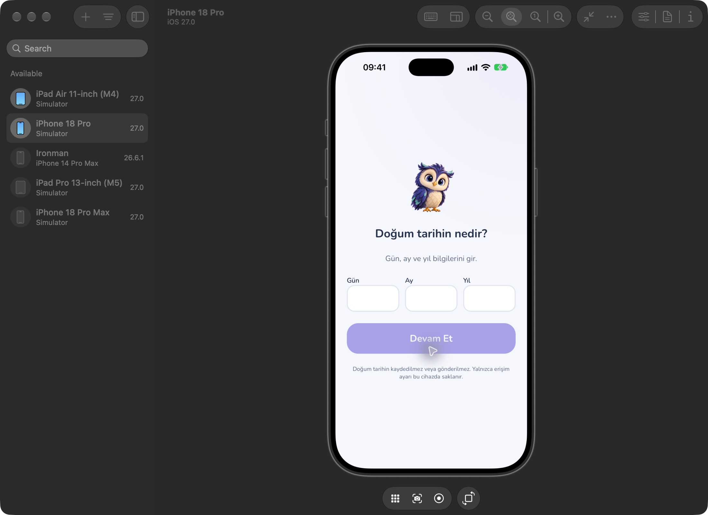
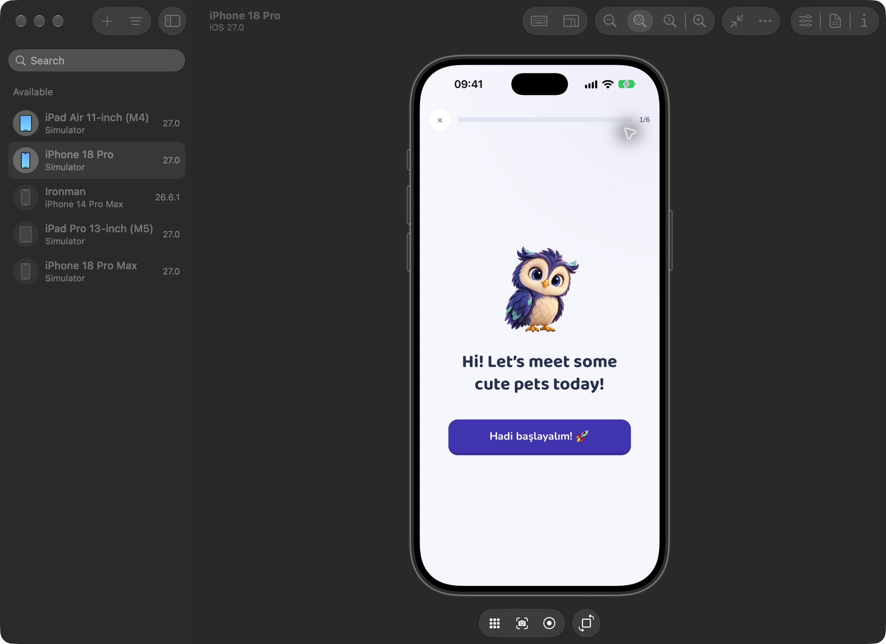
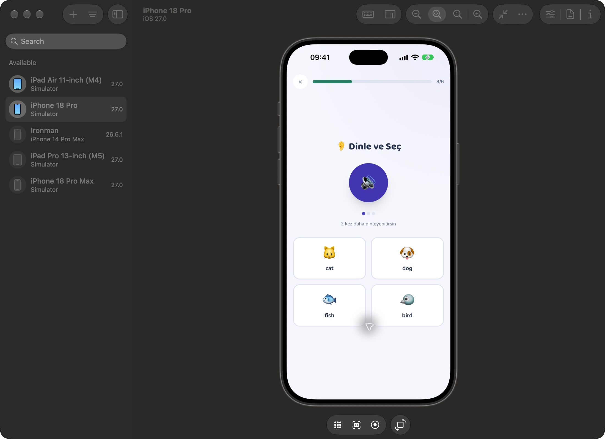
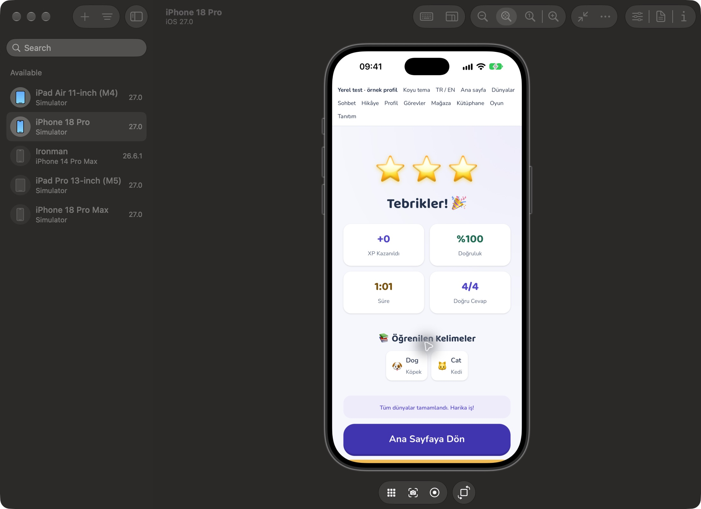
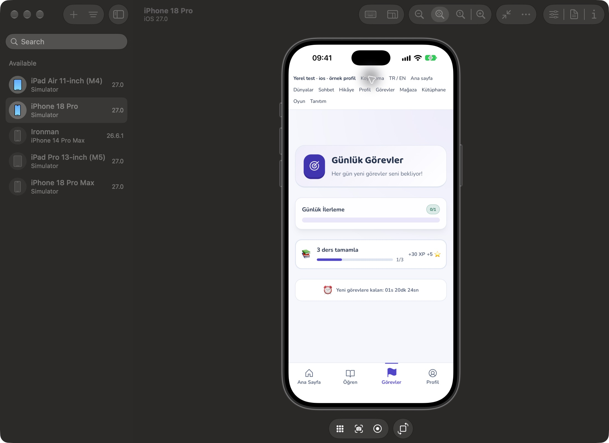
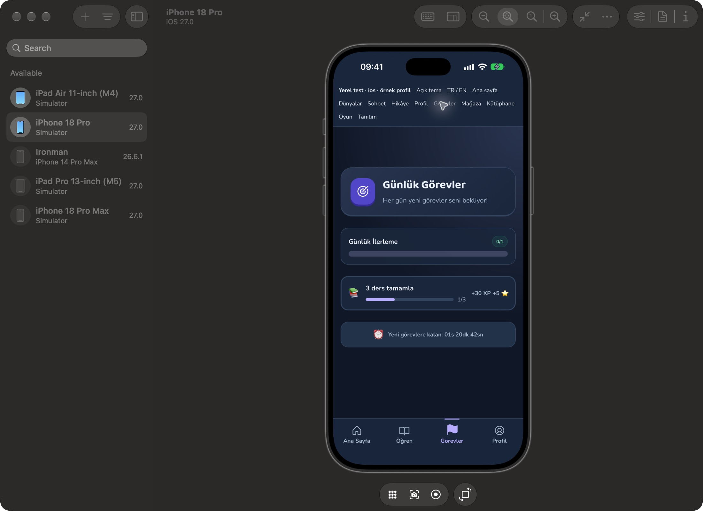
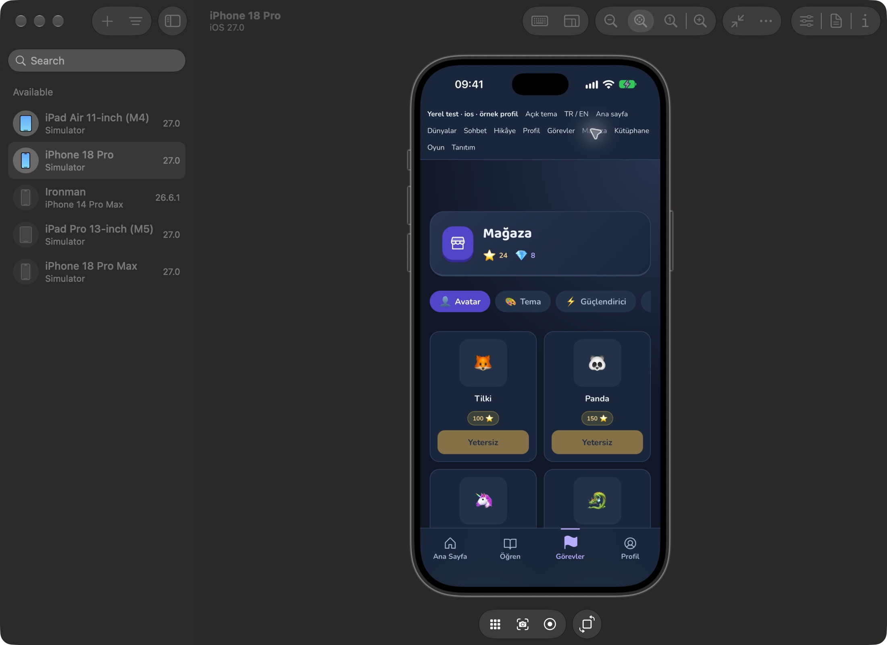
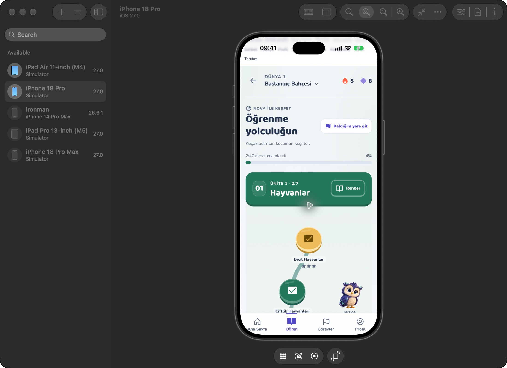

# Nova genel görsel uygulaması ve iOS simülatör kontrolü

21 Ekim 2026 — `codex/nova-visual-v2`, PR #19.

## Genel uygulama

Yeni Nova ve dünya haritalarının görsel dili ders etkinliklerine, ders/sohbet sonuçlarına, profil, günlük görevler, başarılar, koleksiyon, mağaza, hikâye kütüphanesi/okuyucusu, tekrar, tanıtım, ebeveyn, giriş ve yasal ekranlara yayıldı. Ortak yüzey, kenarlık ve metin rolleri açık/koyu temada uygulanır. Indigo eylemler, yeşil başarı, pembe hata ve altın ödüller ayrı okunaklı metin renkleri kullanır. Koyu moddaki geri bildirim metinlerinin CSS değişken kapsamı tarayıcıda bulunup düzeltildi.

Görevler, başarılar, koleksiyon ve mağazada aynı FeatureHeader bileşeni kullanılır. Ders içeriği geniş ekranda 680px ile sınırlıdır; küçük ekranda kelime kartı kullanılabilir genişliğe sığar. Tanıtım, yaş kapısı ve ders giriş/bitiş ekranları ortak Nova varlıklarını kullanır. Hikâye kütüphanesi yeni dört sayfalık Nova hikâyesinin kapağını gösterir; diğer hikâyelerin mevcut görselleri korunur. Native başlangıç storyboard'u aynı Nova ve açık/koyu zemin rengine geçirildi. Native sistem çubuğu ThemeProvider üzerinden güncellenir: açık zeminde koyu, koyu zeminde açık yazı; Android çubuk zemini uygulama zeminini izler. iOS üzerinde Android'e özgü zemin API’si çağrılmaz.

Bu çalışma üç raster Nova pozu kullanır. Meshy modeli kullanıcının hesabında kalır; GLB, rig veya gerçek 3D karakter eklenmedi.

## Otomatik doğrulama

- İlk genel kontrolde 52 dosyada 4.906 test geçti; kapsam eşikleri geçti. Satır/deyim %84,28, dal %67,89, fonksiyon %39,94.
- Üretim TypeScript/Vite derlemesi ve sıfır uyarı kaynak lint kontrolü geçti. Mevcut büyük JS parçası uyarıları sürer.
- `3299bfa` için GitHub lint/type check, unit tests, build ve Netlify önizlemesi geçti (Actions run 39661748945).
- DEV önizleme ve örnek oyun dosyaları üretim `dist` çıktısına dahil değildir.

- Son native kontrast düzeltmesi için üç ek regresyon testi geçti: web üzerinde native çağrı yapılmaması, iOS tema geçişi ve Android zemin eşleşmesi. Son CI koşusu bu testleri de içerir.

## Gerçek iOS simülatörü

Xcode 27.0 / iOS 27.0, iPhone 18 Pro üzerinde ayrı `NovaLingo QA` (`com.novalingo.visualqa`) uygulaması derlendi, kuruldu ve açıldı. İlk açılış paket içindeki üretim web çıktısıyla yapıldı: yeni Nova bulunan yaş kapısı düzgün yüklendi; yaş bilgisi girilmedi.

Oyun ve tema kontrollerinde aynı native Capacitor kabuğu içindeki WKWebView, yerel Vite sunucusundaki DEV önizlemeye bağlandı. Bu önizleme gerçek ekran ve etkinlik bileşenlerini örnek çocuk verisiyle çalıştırır. TanStack sunucu yazımları engellenir; örnek oyun sunucuya ders sonucu göndermez. QA sunucu adresi yalnızca derlenmiş test paketine yazıldı, kaynak Capacitor yapılandırmasına veya üretim paketine eklenmedi.

Simülatörde dokunarak tamamlanan akış:

1. Nova ders girişi.
2. Dog kelime kartını çevirme; köpek ve örnek cümle arka yüzü.
3. Dinle/seç etkinliğinde dog cevabı ve yeşil doğru geri bildirimi.
4. Dog–köpek ve cat–kedi eşleştirmeleri.
5. `I see a ___.` boşluğuna dog seçimi.
6. Nova kutlaması ve ders sonuç ekranı: üç yıldız, %100 doğruluk, 4/4 doğru.

Sonuç ekranındaki +0 XP, sunucu ödülü yazılmayan örnek oturumdan kaynaklanır. Örnek dersin müfredat dışı kimliği, otomatik sonraki derse geçişi durdurur; sonuçtaki “Tüm dünyalar tamamlandı” metni gerçek hesap ilerlemesi değildir. Bu test, gerçek hesapta giriş/müfredat ilerleme/sunucu XP kaydı veya Apple satın alma doğrulaması anlamına gelmez. Mikrofon izni verilmedi ve ses tanıma denenmedi; işitilebilir ses kalitesi bu görsel kontrolde doğrulanmadı.

Dünya haritası, tamamlanmış ders kartı, dokunmatik kaydırma, günlük görevler açık/koyu ve mağaza koyu tema ayrıca cihazda görüntülendi. Tema geçişinde native saat/pil yazılarının doğru kontrasta geçtiği cihazda ayrıca doğrulandı. Yerel test sayfasına üretimle aynı `viewport-fit=cover` ve güvenli alan üst boşluğu eklendi. Tarayıcıda profil, kütüphane, açık/koyu geri bildirim ve mobil taşma kontrolleri yapıldı. Android çalışma zamanı ve fiziksel cihaz testi yapılmadı.

## Yeniden çalıştırma

`pnpm dev --host 127.0.0.1 --port 3002` ile `visual-preview.html?view=home` açılır; üstteki “Oyun” bağlantısı yerel örnek akışı başlatır. Bu dosya yalnızca geliştirme içindir. Normal native derleme `pnpm cap:build:ios` ve Xcode App workspace üzerinden yapılır. QA için ana uygulamanın ve Pod framework'lerinin kimliklerini global xcodebuild değişkeniyle birlikte değiştirmeyin; yalnızca test uygulaması hedefinin kimliğini ayrı tutun.

## Ekran kanıtları

Aşağıdakiler native Device Hub penceresinin doğrudan ekran görüntüleridir; tarayıcı cihaz taklidi değildir.

