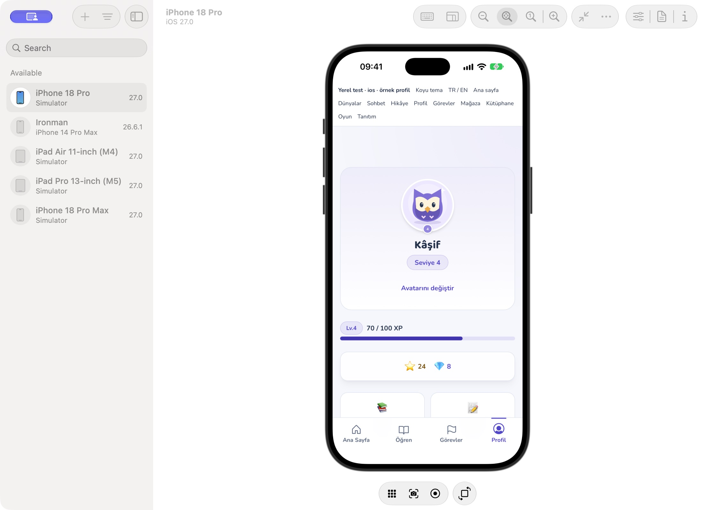
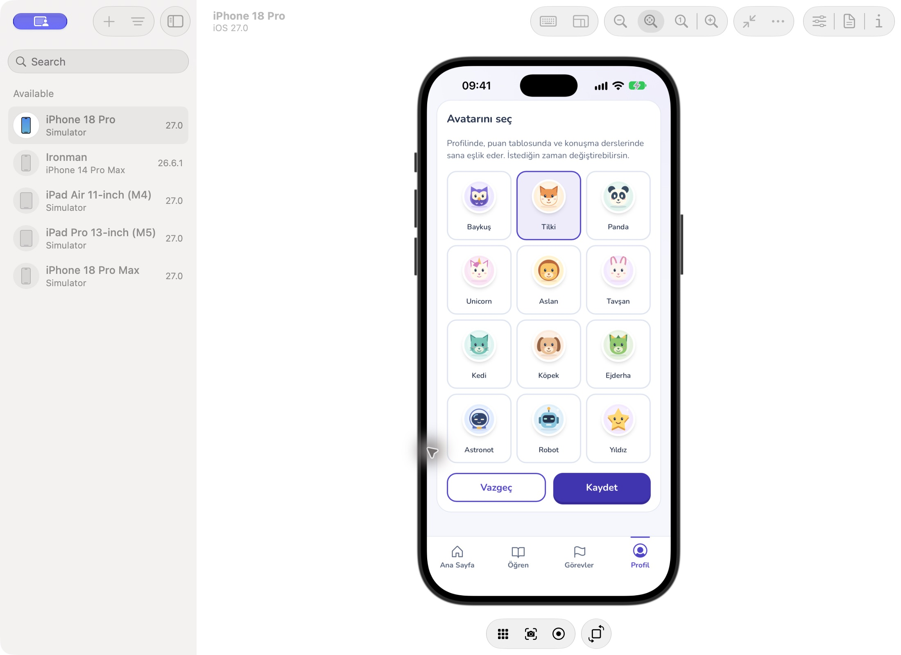
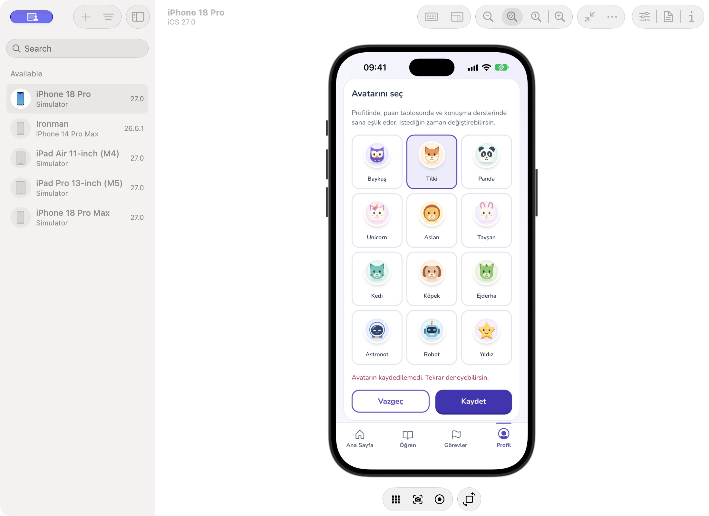

# Profil avatarları

> 24 Ekim 2026 güncel durum: [Tamamlananlar ve kalan işler](2026-10-24-visual-completion-audit.md). Bu belge kendi tarihindeki kapsamı/testleri kaydeder; tüm yol haritasının tamamlandığı anlamına gelmez.

22 Ekim 2026 — PR #19, `codex/nova-visual-v2`.

İlk kurulumdan 12 seçenekli avatar alanı kaldırıldı; yeni profil `owl` ile oluşturulur. Profil ekranındaki “Avatarını değiştir” aynı sayfada sade bir düzenleme görünümü açar. Seçim, Kaydet ve Vazgeç dışında ek adım yoktur. Geçerli avatar seçili gelir; aynı seçimi yeniden kaydetmek gerekmez.

12 özgün yerel SVG rozet yeni mor/pastel temayla uyumludur. Profil, puan tablosu ve konuşmadaki çocuk mesajları aynı çizimi kullanır. `owl` / `fox` gibi kimliklerin resim URL'si sanılıp harf yedeğine düşmesi düzeltildi. Eski `nova_default` / `avatar_default` ve bilinmeyen kimlikler baykuşa döner; sunucudaki eski kayıtlar topluca değiştirilmez.

Kayıt mevcut sahiplik kontrolünü yapan profil servisini kullanır. Yalnız çocuk ID'si ve yeni avatar gönderilir. Kayıt tamamlanmadan yerel avatar değiştirilmez; hata durumunda seçim korunur ve tekrar denenebilir. Kaydetme sırasında seçenekler/düğmeler kilitlenir. Başarı aktif profili ve çocuk listesini günceller; puan tablosundaki kendi satırı taze profil avatarını kullanır. Geç yanıt başka aktif çocuğun avatarını değiştiremez. Vazgeç sunucuya yazmaz; klavye odağı profil düğmesine döner. Diğer çocukların anonim etiketleri korunur.

## Kontroller

- Tam regresyon paketi: 58 dosyada 4.954 test geçti; kapsam eşikleri geçti (satır/deyim %84,62; dal %69,70; fonksiyon %42,71). Son düzenleme görünümünün başarı/iptal dönüşleri dahil 7 editör entegrasyon testi ayrıca geçti. CI tüm son testleri yeniden çalıştırır.
- Tam lint sıfır uyarı ile, TypeScript/Vite üretim derlemesi geçti. Mevcut büyük JS parçası uyarıları devam eder.
- Eski avatar kimlikleri, tüm 12 çizim, çizim değişikliği, fotoğraf yedeği, kurulumda seçim sorulmaması, iptal, başarısız kayıt/tekrar, başarılı kayıt, çift gönderim kilidi, çocuk değiştirme sırasında geç yanıt ve eski puan tablosuna rağmen güncel kendi avatarı test edildi.
- iPhone 18 Pro / iOS 27'de ayrı kurulu NovaLingo QA kabuğunda yerel Vite ekranı dokunarak denendi: profil → avatar düzenleme → Tilki → kaydırma → Kaydet → beklenen yazım engeli hatası → Vazgeç ile eski baykuşun korunduğu profil.

Simülatör önizlemesi tüm sunucu yazımlarını engeller; hata ekranı kasıtlı test sonucudur. Başarılı sunucu yanıtının yerel profile/çocuk listesine yansıması gerçek mutation hook'u ve sahte servis yanıtıyla entegrasyon testinde doğrulandı. Canlı hesaba avatar kaydı, fiziksel cihaz ve Android testi yapılmadı. Native kaynaklar değişmedi; önceki derlenmiş QA kabuğu yeni web kodunu yükler.

## Ekranlar

