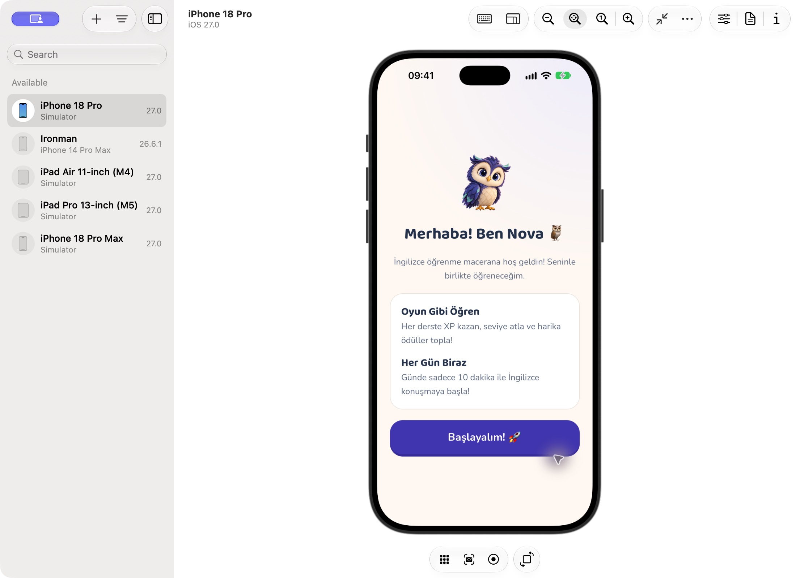
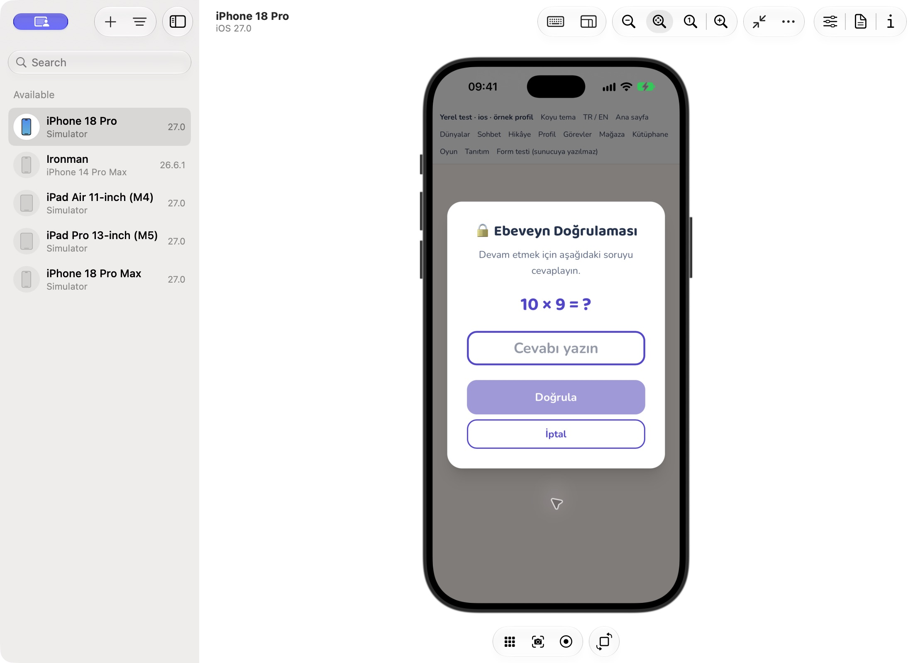
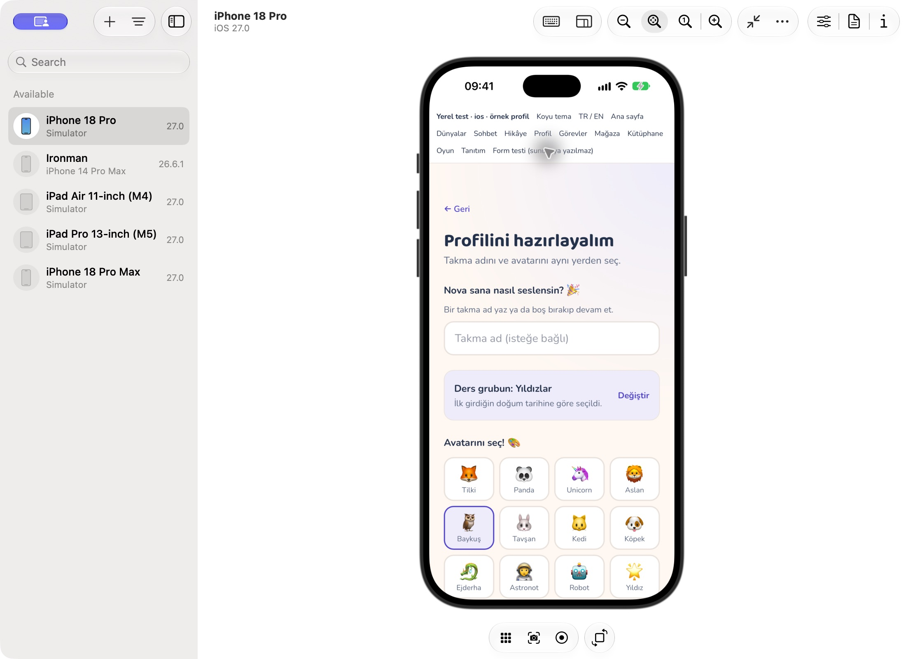
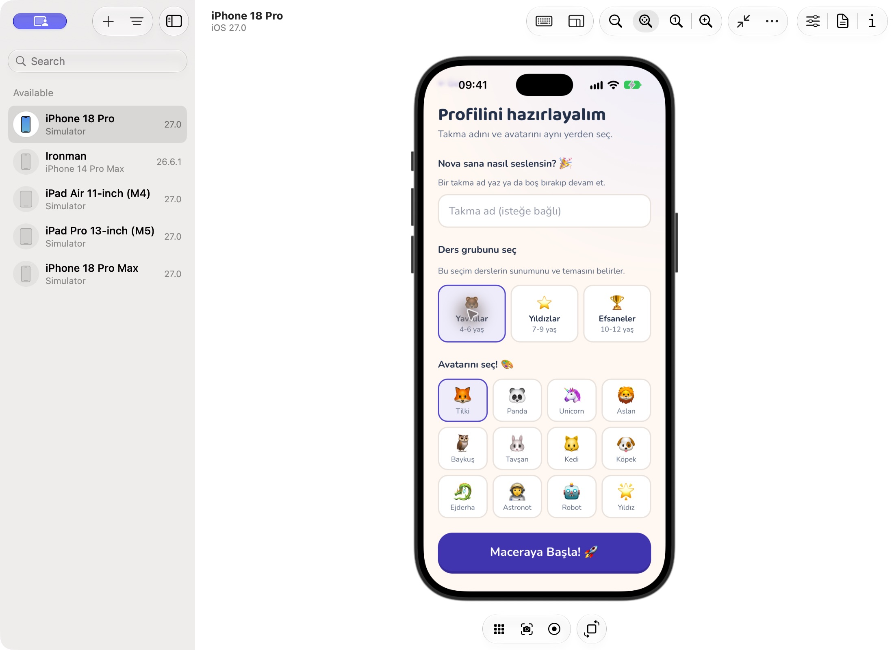
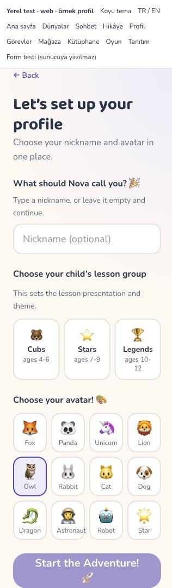

# İlk başlangıç ve profil akışının sadeleştirilmesi

22 Ekim 2026 — PR #19, `codex/nova-visual-v2`.

## Önce / sonra

| Durum                                 | Önce                                                                                           | Sonra                                                                                                  |
| ------------------------------------- | ---------------------------------------------------------------------------------------------- | ------------------------------------------------------------------------------------------------------ |
| İlk çocuk profili                     | Doğum tarihi, dört tanıtım sayfası, ebeveyn kapısı, ad / yaş grubu / avatar için üç ayrı ekran | Doğum tarihi, tek kısa karşılama, ebeveyn kapısı ve tek profil formu; ders grubu önceki tarihten gelir |
| Yetişkin hesap sahibi                 | Kimin yaşının istendiği belirsiz grup seçimi                                                   | Aynı formda açıkça “Çocuğun ders grubunu seç”; yetişkinin tarihinden çocuk grubu çıkarılmaz            |
| Tekrar giriş                          | Giriş işleyicileri tanıtıma gönderir                                                           | Profil varsa ana sayfa; profil yoksa kısa karşılama                                                    |
| Mevcut çocuk listesi, aktif seçim yok | Yeniden profil oluşturmaya yönlenebilir                                                        | İlk mevcut profil seçilir, yeni profil istenmez                                                        |
| Profil adresini doğrudan açma         | Tanıtımdaki ebeveyn kapısı atlanabilir                                                         | Profil formu da ebeveyn kapısı ve iki onay kutusunu gerektirir                                         |

Profilde takma ad isteğe bağlı kalır; Apple/Google sağlayıcısının verdiği geçerli ilk ad önceden doldurulur. İlk kurulum avatar sormaz; varsayılan baykuş ile devam eder. İsteğe bağlı avatar seçimi profil ekranına taşındı. Ders grubu önerisi “Değiştir” ile aynı formda düzenlenebilir. Ders grubu seçenekleri etiketli radyo alanlarıdır; kayıt sırasında devre dışıdır.

Doğum tarihi veya tam yaş tutulmaz/gönderilmez. Mevcut yerel erişim kaydına yalnızca ilk profil için kaba `cubs / stars / legends` önerisi eklenir. Eski kayıtlar uyumludur; eski veya yetişkin kaydında olmayan bir grup uydurulmaz. Öneri ilk başarılı profil kaydından sonra silinir; hata olursa korunur. Ek çocuklar ilk çocuğun grubunu otomatik devralmaz. Erişim sınıfı ile ders grubu bağımsızdır; grup değiştirmek yetişkin erişimi açmaz. TR/EN gizlilik açıklaması buna hizalandı.

Ebeveyn matematik kontrolü ve iki onay kutusu korundu; bu adımlar üretimde otomatik kabul edilmez. Matematik kontrolü tek başına profil oluşturma onayı değildir. Tam onay kısa süre yalnız bellekte tutulur; çıkışta sıfırlanır. Form gönderiminde süre tekrar kontrol edilir; dolmuşsa veri gönderilmeden kapı açılır. Başarı/karşılama geçişlerinde `replace` ile geri tuşunun tamamlanmış kurulumu yeniden açması azaltıldı.

## Doğrulama

- Tam paket: **55 dosya, 4.931 test geçti**. Kapsam eşikleri geçti: satır/deyim %84,46; dal %68,77; fonksiyon %41,91.
- Tam kaynak lint (sıfır uyarı), biçim kontrolü ve TypeScript/Vite üretim derlemesi geçti. Önceden mevcut büyük JS parçası uyarıları sürer.
- Testler: yaş grubu doğum günü sınırları, tarih içermeyen saklama/yeniden yükleme/tüketim, yetişkin/bozuk/eski kayıtlar, ek çocuk, doğrudan kurulum kapısı, süresi dolmuş onay, kayıt hatası, isteğe bağlı ad/Apple adı, tek form, mevcut profilde tanıtımı atlama ve giriş hedefi.
- 320px tarayıcı kontrolünde çocuk/adult, TR/EN, grup/avatar seçimi ve koyu tema; yatay taşma yok.
- iPhone 18 Pro / iOS 27 simülatöründe kurulu ayrı `NovaLingo QA` kabuğu ile yerel Vite ekranları dokunarak denendi: örnek çocuk tarihi → tek karşılama → ebeveyn kapısı → iptal ile karşılama. Ardından yalnız DEV test kontrolüyle açılan formda tarih kaynaklı Yıldızlar özeti, aynı sayfada grubu Yavrular'a değiştirme, Tilki avatarı, kaydırma ve kayıt düğmesi kontrol edildi.

Simülatör denemesi gerçek hesap açmaz. DEV önizlemesinin “Form testi (sunucuya yazılmaz)” kontrolü bellek içi test onayını kurar; üretim çıktısında bu kontrol/rota yoktur. TanStack mutation öncesi yazımlar engellenir; formun kayıt denemesinde beklenen “server writes are disabled” mesajı görüldü. Gerçek ebeveyn adına sözleşme kabul edilmedi, Firebase'e çocuk profili yazılmadı. Başarılı kayıt callback'i ve öneriyi tüketme davranışı birim testlerinde doğrulandı. Canlı hesapla uçtan uca kayıt, fiziksel cihaz veya Android çalışma zamanı testi yapılmadı. Native Swift/Storyboard bu değişiklikte değişmedi; kurulu kabuk önceki başarılı native derlemedir ve yeni web kodunu yerel sunucudan yükler.

DEV önizleme `visual-preview.html?setup=fresh`, `?setup=child` veya `?setup=adult` ile açılır. Yalnız geliştirme girişidir; normal uygulamanın yaş kapısı öncesi Firebase yüklememe düzeni korunur.

## Ekran kanıtları

Son avatar düzenlemesi ve güncel doğrulama: [Profil avatarları](2026-10-22-profile-avatars.md). Yukarıdaki başlangıç ekranları avatar seçimi taşınmadan önceki akışın kayıtlarıdır.
