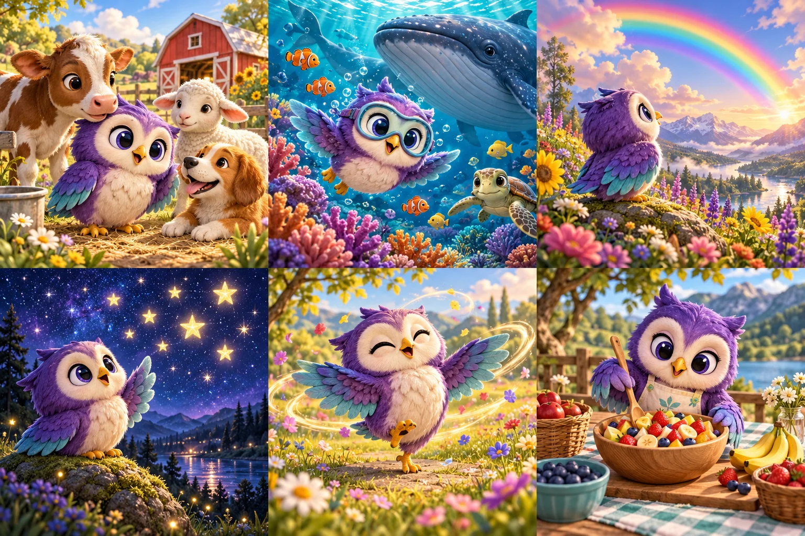

# Resimli hikâye kütüphanesi

> 24 Ekim 2026 güncel durum: [Tamamlananlar ve kalan işler](2026-10-24-visual-completion-audit.md). Bu belge kendi tarihindeki kapsamı/testleri kaydeder; tüm yol haritasının tamamlandığı anlamına gelmez.

23 Ekim 2026.

Kütüphane daha önce yalnız `/story/nova-v2/` altındaki özel hikâyenin görselini gösteriyor, diğer kartlarda dünya emojisi kullanıyordu. Eski sayfa JPEG'lerinin çoğu metinli yer tutucuydu. Yeni kapaklar sayfa medyasından bağımsızdır; hikâye içeriği veya sesleri değiştirilmedi.

36 Nova'lı sahne, yerleşik `image_gen.imagegen` ile altı 3×2 görsel sayfası olarak üretildi. Kalıcı dosyalar `public/story/covers-v1/` içindedir: `early-learning.webp`, `everyday-life.webp`, `friends.webp`, `our-world.webp`, `discoveries.webp`, `creative-world.webp`. Toplam 2.28 MiB. Kaynak PNG'ler değiştirilmeden WebP kodlandı; kartlar CSS konumlandırması ile doğru kareyi gösterir. Tarayıcı aynı temadaki kartların dosyasını tekrar indirmez. İlk dört kapak hemen, diğerleri görünür alana yaklaştığında yüklenir. Boyutlar ayrılmıştır; yükleme hatasında kartın adı, dünya emojisi ve açma düğmesi kullanılabilir kalır.

104 hikâyenin tamamı temalı bir çizime bağlandı. Deniz/orman hikâyeleri için özel sahne eşleştirmesi vardır; mevcut “Nova Mutlu!” kapağı korunur. Kapaklar tema başına paylaşılır; her hikâye için 104 ayrı resim veya tüm iç sayfaların yeniden çizimi yapılmadı.

Dünya filtresi 12 dünyayı kapsar. Dünya ID ayrıştırması `w10/w11/w12` değerlerini `w1` sanmaz. TR/EN dünya etiketleri eklendi; hikâye başlıkları etkin dilde gösterilir. Filtre düğmeleri seçimlerini erişilebilirlik ağacına bildirir.

## Doğrulama

- 11 odaklı test geçti: tüm temaların/dosyaların varlığı, kapakların toplam boyutu, atlas hücreleri, özel Nova kapağı, çok basamaklı dünya ID'leri, tüm dünya filtreleri ve hata sonrası hikâyeyi açma.
- Tam lint, TypeScript ve Vite üretim derlemesi geçti. Önceden mevcut büyük JS parçası uyarıları sürer.
- Yerel tarayıcı önizlemesinde çiftlik/deniz/gökkuşağı/yıldız kapakları görsel olarak doğrulandı. Sonraki mobil kontrol aşamasında Work ayarlarında yerel tarayıcı erişimi kapalıydı; ek dar ekran/simülatör kontrolü tamamlanmadı. Bu değişiklik için native derleme veya fiziksel cihaz testi yapılmadı.
- Üretim derlemesinde altı kapak dosyası mevcuttur. CI ayrıca PR üzerinde çalışır.

Üretim aracı ve tam prompt seti: [Kapak promptları](2026-10-23-story-cover-prompts.json).

Sonraki ekleme: [Çiftlik hikâyesinin beş iç sayfa çizimi ve simülatör kontrolü](2026-10-23-farm-story-illustrations.md).
