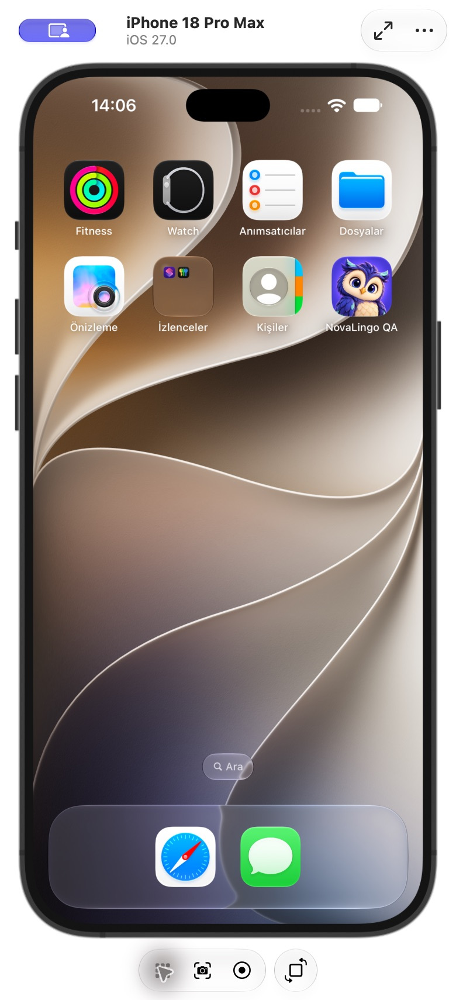

# NovaLingo görsel çalışmalarının güncel durumu

24 Ekim 2026. **Hayır, ilk incelemedeki bütün hedefler tamamlanmadı.** Ortak görsel dil, öğrenme yolu ve sade başlangıç akışı uygulandı; ileri karakter animasyonu, katalogdaki tüm iç çizimler ve tam cihaz doğrulaması açık kaldı.

Bu karşılaştırma bu sohbette hazırlanan `docs/design/` altındaki önceki **10 Markdown dosyasını** kapsar. Eski belgeler tarihli uygulama/inceleme kayıtlarıdır; içlerindeki eski test sayıları güncel toplam değildir. Ürün mimarisi, ödeme, müfredat ve konuşma için depoda bulunan diğer ekip planlarının tümünün bittiği iddia edilmez. İnceleme dalı `codex/story-library-covers`, başlangıç commit'i `ddeca50`.

## Kod, birleşme ve yayın ayrımı

- Ortak Nova/tema, yol, başlangıç ve avatar çalışmaları #19/#21 üzerinden ana dala birleşti.
- 104 kütüphane kapağı, çiftlik hikâyesinin beş çizimi ve bu ikon/durum güncellemesi **PR #23** içindedir. 24 Ekim kontrolünde PR açık; bu çalışma otomatik birleştirme yapmaz.
- Kodun yazılmış olması App Store / Google Play'deki ikili paketin güncellendiği anlamına gelmez. Bu çalışmada mağaza paketi gönderilmedi. Canlı sürümün bütün bu değişiklikleri içerdiği doğrulanmadı.

## Belgelerin tek tek karşılığı

| Belge | Durum | Kodda/çıktıda karşılığı ve açık sınır |
|---|---|---|
| [Görsel inceleme ve Nova v2 yönü](2026-10-21-visual-audit.md) | Kısmen tamam | Ortak kaynak, yüzen hareketin kaldırılması, tema/kontrast, ana ekran ve yol uygulandı. Aşağıdaki hareket, katalog, ikon ve cihaz maddeleri açık. |
| [Meshy üretim brifi](nova-v2-meshy-brief.md) | Kullanıcı kararıyla ertelendi | Model veteroner hesabında üretildi. İndirme abonelik istedi; kullanıcı modelin hesapta kalmasını ve görsel sürümün bitirilmesini istedi. GLB/rig/klipler yok; yeni ödeme yapılmadı. Ortak `NovaCharacter` arayüzü ise artık var. |
| [Görsel pilot uygulaması](nova-v2-implementation.md) | Belgedeki pilot tamam | Üç Nova pozu, orman, ortak bileşenler, ana ekran/sohbet ve dört sayfalık “Nova Mutlu!” var. Bu, yedi ayrı hareketin veya gerçek 3D'nin tamamlandığı anlamına gelmez. |
| [Varlık üretim istemleri](nova-v2-asset-prompts.md) | Tamam | Üç Nova, orman ve dört hikâye sahnesi diskte ve tüketen bileşenlerde var. İstem kaydıdır; ilave uygulama kapsamı değildir. |
| [Öğrenme yolu](2026-10-21-learning-path.md) | Belgedeki kapsam tamam | 12 dünya, ünite rehberi, ders bilgisi, mevcut derse gitme, ilerleme/kilit kuralları ve açık/koyu palet. Duolingo'nun bütün ürün özellikleri uygulanmadı ve bu belgede de vaat edilmedi. |
| [Genel görseller ve simülatör](2026-10-21-global-visuals-simulator.md) | Arayüz kapsamı tamam, cihaz kapsamı kısmi | Ortak yüzeyler ekranlara yayıldı; iOS QA kabuğunda örnek ders tamamlandı. Android açılış varlıkları eski; Android çalışma zamanı, fiziksel cihaz ve canlı hesapla uçtan uca akış belgenin kapsamı dışında kalmıştı. |
| [Başlangıç sadeleştirmesi](2026-10-22-setup-flow.md) | Belgedeki kapsam tamam | Yaş bilgisi aynı kişi için tekrar sorulmaz; ilk çocuk grubuna kaba öneri gelir. Yetişkinin tarihi çocuk grubuna çevrilmez; ebeveyn kapısı/onay korunur. İlk kurulumda avatar adımı yok. |
| [Profil avatarları](2026-10-22-profile-avatars.md) | Belgedeki kapsam tamam | Profilde isteğe bağlı düzenleme, 12 SVG ve profil/puan tablosu/çocuk sohbet avatarının ortak çizimi. Başarı/hata/geç yanıt testleri var; gerçek hesapta kayıt testi yapılmış sayılmaz. |
| [Kütüphane kapakları](2026-10-23-story-library-covers.md) | Belgedeki kapsam tamam, PR açık | 36 sahneyi paylaşan 104 kapak, 12 dünya filtresi, TR/EN ve yükleme hatası yedeği var. 104 ayrı sahne veya 104 hikâyenin bütün sayfaları üretilmedi. |
| [Çiftlik iç çizimleri](2026-10-23-farm-story-illustrations.md) | Belgedeki kapsam tamam, PR açık | Beş ayrı çizim, İngilizce metnin son sayfada da görünmesi, ses/kelime koruması ve iOS QA ekran kanıtları. “Nova Mutlu!” ile birlikte toplam iki tam hikâye / dokuz iç sahne yenilendi. |

## İlk incelemedeki bulguların karşılığı

| İlk bulgu/hedef | Durum | Doğrulanan karşılık / kalan iş |
|---|---|---|
| Ekranlar farklı Nova kaynakları kullanıyor | Büyük ölçüde tamam | `NovaStageAvatar` ve `NovaCompanion`, `NovaCharacter` kullanır; giriş/sonuç/sohbet de ortak kaynağa bağlı. Görsel hatası yedeği eski SVG'dir; tamamen yeni bir karakter kaynağından üretilmiş bir yedek değildir. |
| Tüm gövdenin sürekli yüzmesi | Tamam | Sürekli karakter salınımı yok; temas gölgesi ve olay anında 0,7 saniyelik tek kutlama var. |
| Sarı butonda beyaz yazı | Ortak butonda tamam | `Button.secondary` koyu yazı; başarı/hata için koyu zemin. Tema testleri 3 yaş × 2 modda ortak renk çiftlerini kontrol eder. Her özel küçük etiketin ölçüldüğü iddia edilmez. |
| Metinli hikâye kartları | Kısmi | İki hikâyenin dokuz iç sahnesi yeni. Kalan 102 hikâyenin iç sayfalarını tarama/yenileme bitmedi; tüm kapaklar mevcut. |
| Semantik tema/yüzeylerin atlanması | Büyük ölçüde tamam | Tema renkleri, ortak navigasyon/butonlar ve yüzeyler bağlı. Yerel sabit renkler ve özel rozetler sürüyor; bütün ekran/durum kontrast envanteri yok. |
| Eksik renk/font tokenları | Tamam | `background-primary`, `text-primary`, `nova-sky`, `font-heading` eşlemeleri `globals.css` içinde tanımlı. |
| Duruma özel Nova ifadesi/hareketi | Kısmi | Yalnız `idle/listen/celebrate` görselleri var. `thinking/sleeping/encouraging/sad` aynı dinleme pozuna yönlenir; konuşma nötr pozu kullanır. Gerçek göz kırpma, nefes, bakış, gaga/TTS senkronu yok. |
| Kompakt sohbet ve belirgin ana eylem | Tamam | Küçük ortak sohbet avatarı; ana ekranda mevcut derse odaklı `NovaHomeHero`. |
| Bağlantılı dünya yolu ve mevcut ders | Tamam | `WorldMapScreen`, `learningPath` ve yol stilleri. Her dünya için ayrı tam arka plan sahnesi yok; renk ve yol düzeni var. |
| Tek ikon ailesi ve özgün ödül varlıkları | Kısmi | Gezinme/ders düğümleri/başlıklarda Phosphor; profil avatarları özgün SVG. Mağaza, koleksiyon ve bazı etkinlik içerikleri hâlâ emoji kullanır. |
| Daha okunaklı küçük etiketler | Kısmi | Başlık fontu düzeldi; `SeasonalEventScreen` gibi yerlerde `text-[10px]` ve küçük etiketler sürüyor. |
| Geçilebilir evrim / dersi bloke etmeme | Kısmi | Aynı Nova yüzü korunur, aşamalar işaret/ölçekle ayrılır. `NovaEvolutionModal` ilk fazda yalnız “Evrimleş” gösterir; baştan atlama eylemi yok. |
| Hareketi azalt / görünmeyen ekranda durma | Kısmi | CSS ve `MotionConfig reducedMotion="user"` var. Karakterde sürekli döngü yok; genel görünürlük/App arka planı duraklatma mekanizması bu çalışmada tamamlanmadı. |
| iOS/Android, çevrimdışı ve düşük cihaz kontrolü | Kısmi | iOS simülatör örnek akışları ve dar web ekranları kontrol edildi. Android çalışma zamanı, fiziksel/düşük donanım, tam çevrimdışı açılış ve bellek/FPS ölçümleri eksik. |

Kod kanıtları: [NovaCharacter](../../src/components/molecules/NovaCharacter/NovaCharacter.tsx), [hareket ve tokenlar](../../src/styles/globals.css), [tema](../../src/config/theme.ts), [buton](../../src/components/atoms/Button/Button.tsx), [ana ekran](../../src/features/home/screens/HomeScreen.tsx), [yol](../../src/features/home/screens/WorldMapScreen.tsx), [kapak eşlemeleri](../../src/features/learning/data/storyCovers.ts), [hikâyeler](../../src/features/learning/data/storyBank.ts), [evrim](../../src/components/organisms/NovaEvolutionModal/NovaEvolutionModal.tsx), [mağaza](../../src/features/gamification/screens/ShopScreen.tsx), [küçük etiket örneği](../../src/features/gamification/screens/SeasonalEventScreen.tsx), [yaş politikası](../../src/services/ageScreen/ageScreenPolicy.ts).

## Yeni uygulama ikonu

Bu eklemede eski kepli çizim yerine mevcut Nova kimliğinin yakın portresi kullanılır. Yerleşik `image_gen.imagegen` ile opak ana ikon ve saydam Android ön planı üretildi; kaynaklar [assets/branding](../../assets/branding/) içinde, [istemler burada](2026-10-24-app-icon-prompts.json).

- iOS: 1024×1024 RGB, alfa kanalı veya resme gömülü yuvarlatılmış köşe yok.
- Android: beş yoğunlukta normal/round ikonlar ve ayrı saydam adaptif ön plan. Görünür portre teknik dışa aktarımda merkezdeki çember içine sığdırılır; arka plan indigo.
- Web: sekiz PWA boyutu, favicon, Apple Touch Icon ve ayrı maskable 512px dosyası. Manifest maskable işaretini yalnız ayrı güvenli alana sahip dosyada kullanır.
- `scripts/generateAssets.py` artık eski baykuşu yeniden çizmez; onaylanan iki master'dan boyutları dışa aktarır. Açılış görsellerini ezmez. Pillow yalnız boyutlandırma, saydam kenar boşluğu ve platform paketi üretimi için kullanılır.
- **Android `drawable*/splash.png` açılış görsellerinde eski Nova hâlâ vardır.** İkonla karıştırılmamalı; sonraki ortak kimlik işi budur. iOS storyboard'u zaten yeni Nova kullanır.

## Kalan iş sırası

1. Android açılış görsellerini ve eski SVG karakter hata yedeğini yeni kimliğe geçirmek; evrime baştan atlama; küçük etiket/özel rozet okunabilirliğini tamamlamak.
2. Hikâye iç çizimlerini metin/sahne/soru uyumuyla kalan kataloğa yaymak. Tek bir kapağı tüm sayfalara kopyalamak tamamlanma sayılmaz.
3. Raster sürümde ayrı düşünme/cesaret/uyku/konuşma ifadeleri; gerekiyorsa göz/gaga kontrolleri. Gerçek 3D bu işlerin ön koşulu değildir.
4. Ödül/mağaza ikonlarını aynı aileye taşımak, tema ve hareket azaltma durumlarının tümünü kontrol etmek.
5. Android/fiziksel cihaz, çevrimdışı/düşük donanım, gerçek hesap/ses ve satın alma akışlarını ayrı test etmek. Bu görsel QA kayıtları bunların yerine geçmez.

Meshy dışa aktarma ve rig, kullanıcının modelin hesapta kalması kararına göre ertelenmiştir; mevcut onay yeni abonelik veya ödeme içermez.

## Bu kontrolün doğrulamaları

- 27 launcher/PWA çıktısının boyutları, manifest yolları ve RGB/saydamlık koşulları kontrol edildi. Android adaptif ön planlarının görünür pikselleri merkezdeki güvenli çember içinde kalır. 72px normal ikon ve 512px maskable çıktı ayrıca görsel olarak incelendi.
- Tema kontrastı, native tema sağlayıcısı ve ortak Nova testlerinden **42 test / 3 dosya geçti**. Üretim Vite derlemesi ve iOS web varlıklarını eşitleme (`cap sync ios`) başarılı. Mevcut büyük JS parçası uyarıları sürer.
- Xcode `actool`, AppIcon kataloğunu iPhone/iPad simülatör hedefi için başarıyla derledi. Yeni `Assets.car` ve ikon çıktıları mevcut **ayrı QA kabuğunun bir kopyasına** kondu; yalnız `com.novalingo.visualqa` kuruldu. Native Swift/framework kodu yeniden derlenmedi; üretim uygulamasının kimliği veya hesabı değiştirilmedi.
- iPhone 18 Pro Max / iOS 27 ana ekranında yeni Nova ikonu “NovaLingo QA” adıyla görüldü. Bu, Android çalışma zamanı veya mağaza yayını testi değildir.
- PR #23 kontrolleri son commit için ayrıca çalışır. Önceki `ddeca50` koşusunda 4.971 test, kapsam eşikleri, lint/tip kontrolü, üretim derlemesi ve Netlify önizleme geçmişti; son durum PR üzerinden okunmalıdır.

