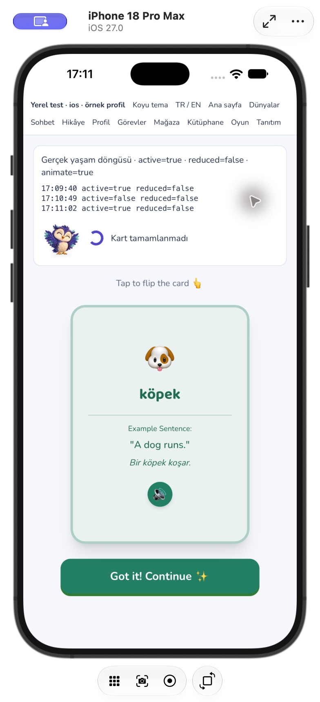
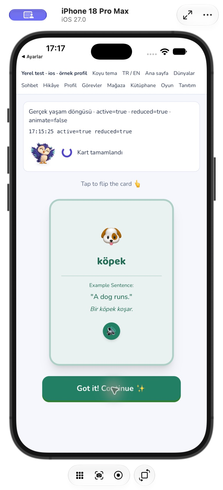

# NovaLingo — arka plan ve hareket azaltma

25 Ekim 2026. Ortak hareket politikası, görünür belge ve etkin native uygulama koşulunu birlikte kullanır. İşlevsel ders süresi, boss geri sayımı, ses/kayıt servisi ve ödül hesaplama kuralları değiştirilmez.

## Uygulama

- `AppMotionProvider`, auth yükleme ekranını da içerecek şekilde kökte bağlanır. Webde `visibilitychange`, native ortamda `App.getState()` ve `appStateChange` izlenir. Geciken ilk sorgu, daha yeni yaşam döngüsü olayının üstüne yazamaz. Geciken dinleyici kaydı da unmount sonrasında temizlenir.
- OS `prefers-reduced-motion` başlangıçta okunur ve `change` olayıyla canlı izlenir. Sürekli Framer döngüleri yalnız etkin/görünür ve hareket azaltılmamış durumda çalıştırılır; diğer durumda hedefler tek sabit değere geçer, sonsuz tekrar kaldırılır. Uygulama gizlenince CSS animasyonları ve pseudo element döngüleri ortak kapsayıcıda durur. Mevcut CSS hareket azaltma kuralları ve Framer sonlu geçiş ayarı korunur.
- Kapsam: lig simgesi, kelime kartının ön yüzü, mikrofon nabzı, konuşma ilerleme noktaları/ses çubukları/düşünme noktaları, ders yükleme simgesi, boss kalpleri ve son saniye uyarısı. Kayıt/ses durumu metin ve sabit sembolle görünür kalır; aktivite callback'leri değişmez. Kartın arkası açıkken görünmeyen ön yüzdeki nabız da durur.
- Hareket azaltmada kart yine çevrilir, beklemeden son açıya gider ve normal tamamlanma callback'i çalışır. Çocuklar yeniden mount edilmez; cevap/kart durumu görünürlük değişiminde korunur.
- Nova tek kutlama hareketini politikaya bağlar. Evrim dönüşümü sürerken uygulama pasif olur veya hareket azaltma açılırsa eski timer temizlenip yeni aşama gösterilir; yeniden bekleme oluşmaz. Konuşma düşünme göstergesinde gerçek düşünme pozu kullanılır.
- Konuşma XP sayacının kozmetik interval'i pasif/hareket azaltılmış durumda gerçek toplamda tamamlanır. Dönüşte aynı ödül baştan sayılmaz; sıfır ödül doğru gösterilir. Sunucu ödülü değiştirilmez. Sonuçtaki sonlu koleksiyon nabzı da politikayı izler.

## Doğrulama

- **36 test / 6 dosya:** görünürlük ve native etkinliğin birlikte değerlendirilmesi, geciken ilk sorgu, geciken dinleyici temizliği, native hata, OS tercihini iki yönde değiştirme, yanıt/mount koruması, kart çevirme/tamamlama, evrim ortasında hareketi kapatma, XP sayacının dönüşte tekrarlamaması; mevcut Nova ve konuşma regresyonları.
- Lint, `tsc -b`, üretim web derlemesi; Capacitor iOS/Android kaynak eşitlemesi; Xcode iOS simülatör ve Android `assembleDebug` derlemeleri başarılı. Kaynak biçim kontrolü geçti.
- iPhone 18 Pro Max / iOS 27'de sunucuya yazmayan `com.novalingo.visualqa` kabuğunda gerçek ana ekrana çıkış ve geri dönüş yapıldı. Günlük `active=true → false → true` gösterdi; çevrilmiş kart aynı yüzünde kaldı. Bu sahte yaşam döngüsü olayı gönderilerek yapılmadı.
- Simülatörün Ayarlar → Erişilebilirlik → Hareket → Hareketi Azalt tercihi açıldı. Uygulama `reduced=true / animate=false` gösterdi; yükleme halkası sabit kaldı, kart çevrilip tamamlanabildi. Tercih değişimi sırasında QA web oturumu yeniden açıldığı için bu manuel kanıt **ilk açılış tercihi** içindir; aynı mount'ta canlı değişim otomatik testlerle doğrulanır.
- Simülatörün Hareketi Azalt ve iOS tarafından buna bağlı değiştirilen mesaj efekti tercihleri test öncesindeki değerlerine geri getirildi. Normal uygulamanın yeni iOS paketi veri silmeden kuruldu. QA göstergeleri yalnız dev fixture içindedir, üretim ekranlarına eklenmez.

## Sınırlar ve kalanlar

Bu tur sürekli dekoratif döngüleri durdurur; bütün sonlu giriş/çıkış animasyonlarını veya oyun/ses saatlerini donduran bir motor değildir. Framer'ın sonlu geçişleri OS tercihini bağlanırken alır; her mevcut sonlu varyantın ayar değişimi ortasında yeniden planlanması bu kapsamda doğrulanmadı. Ekranda kaydırmayla görüş dışına çıkan her bağımsız kart için IntersectionObserver envanteri de yapılmadı. Android manuel görünüm, fiziksel/düşük donanım, bellek/FPS ölçümleri ve gerçek hesap/ödeme/ses uçtan uca kontrolleri açık. Görsel planların tamamının bittiği iddia edilmez.
