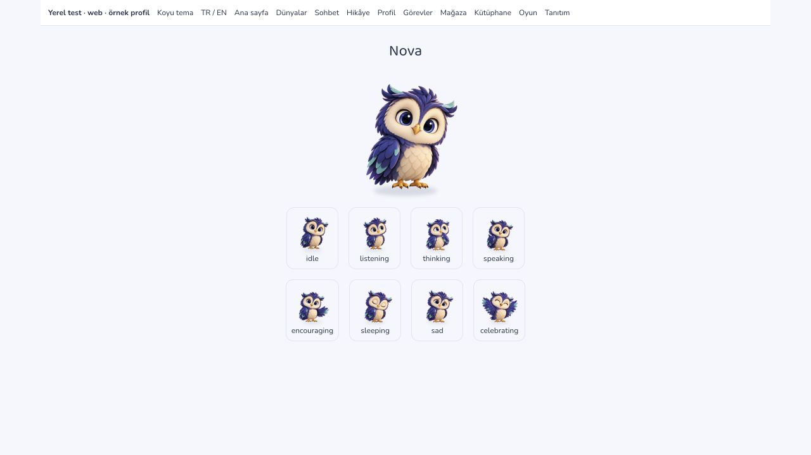
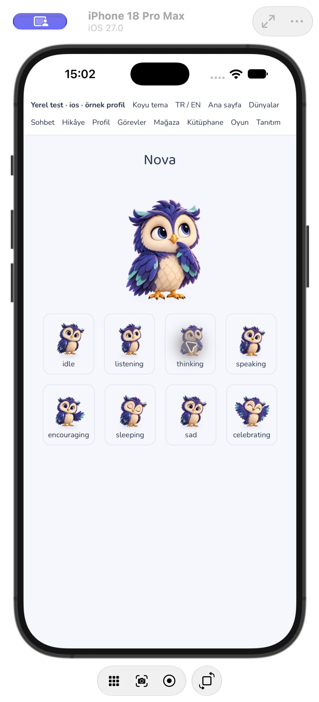
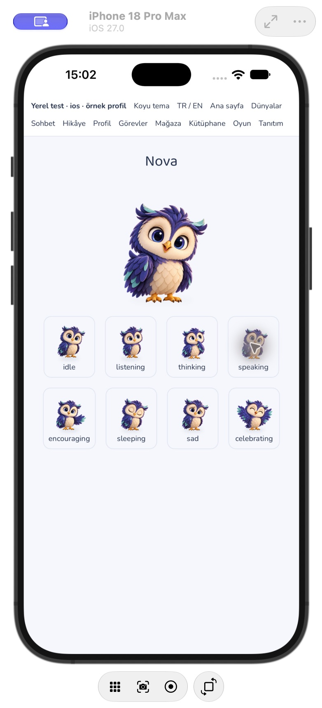
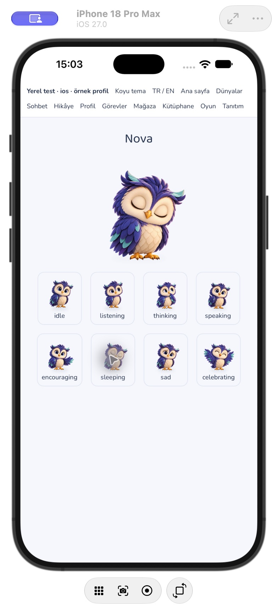
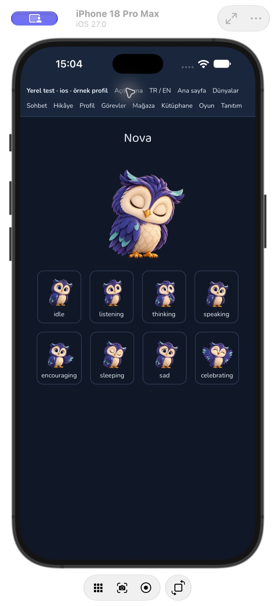
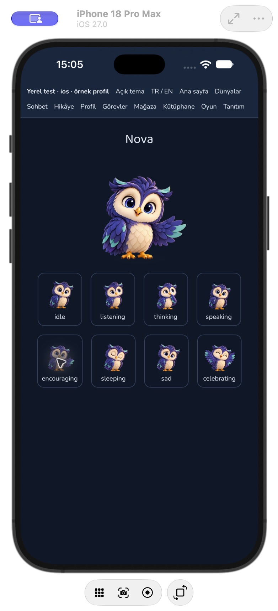
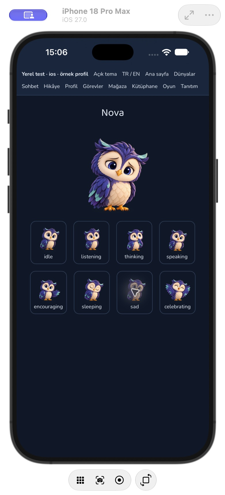
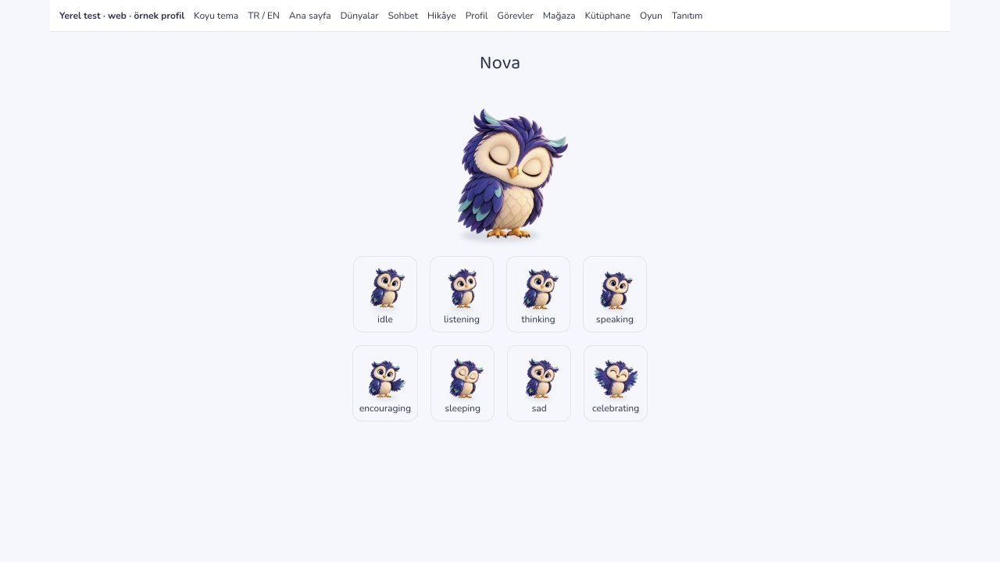

# Nova ifade seti ve görsel hata yedeği

25 Ekim 2026. Görsel incelemedeki ayrı ifade ve eski SVG yedeği maddeleri tamamlandı. Bu çalışma raster durum pozlarıdır; iskelet/GLB, göz kırpma veya hece/fonemle eşleşen gaga animasyonu içermez.

## Yeni set

Yerleşik `image_gen.imagegen` ile mevcut `public/nova/nova-idle.webp` kimliği referans alınarak beş yeni saydam poz üretildi: **düşünme, uyku, cesaretlendirme, konuşma ve üzgün**. İndigo/krem/mint renkler, yüz oranları, tüyler ve iki ayak korunur; aksesuar veya dekor eklenmez. Beş kaynak PNG ayrı ayrı görsel olarak incelendi.

[Kesin üretim istemleri ve kaynak dosya adları](2026-10-25-nova-expression-prompts.json). Kaynak PNG'ler ImageGen'in `generated_images` dizininde korunur. Uygulamada tüketilen sekiz WebP çıktısı `public/nova/poses-v3/` içindedir; önceki üç kaynak dosya ezilmedi.

| Uygulama durumu               | Görsel           |
| ----------------------------- | ---------------- |
| idle                          | idle.webp        |
| listening                     | listen.webp      |
| thinking                      | thinking.webp    |
| speaking                      | speaking.webp    |
| encouraging                   | encouraging.webp |
| sleeping                      | sleeping.webp    |
| sad                           | sad.webp         |
| happy / excited / celebrating | celebrate.webp   |

Mevcut nötr/dinleme/kutlama pozları da aynı 768×768 saydam çerçeveye teknik olarak dışa aktarıldı. Sekiz görüntü aynı ayak hizasını kullanır; toplam **605.296 bayt** (yaklaşık 591 KiB). `scripts/exportNovaPoses.py` yalnız onaylı görsellerin kırpma, padding, ölçekleme ve kodlamasını yapar; sanat üretmez. Dışa aktarmayı yinelemek için istem kaydındaki beş orijinal dosyanın bulunduğu dizin `--generated-dir` ile verilir.

## Hata ve çevrimdışı davranış

- Eski `nova-mascot.svg` görsel hata yedeğinin yerine aynı Nova'nın 256×256 PNG'si (`src/assets/images/nova-fallback-v2.png`, 70.275 bayt) geçer. Vite `?inline` ile JS paketine gömülür; ikinci bir görsel isteğine bağlı değildir. Üretim JS dosyası içinde tam PNG içeriği bayt düzeyinde doğrulandı. [Vite varlık gömme belgesi](https://vite.dev/guide/assets.html#explicit-inline-handling).
- Hata durumu artık o pozun görüntü yaşam süresine aittir. Bir poz yüklenmezse yeni Nova yedeği görünür; sonraki ifade kendi kaynağını yükler. Sorunlu poza geri dönülürse yeniden denenir. Aynı hata yüzünden bütün sonraki ifadeler kalıcı yedeğe düşmez.
- Gerçek sohbet durumları ortak bileşene zaten bağlıydı. Önceden düşünme ve dinleme aynı resmi gösterdiği için test bunu ayırt etmiyordu. Test artık TTS öncesi düşünme → ses başlangıcında konuşma → ses bitiminde dinleme sırasını ayrı resimlerle doğrular. Ses/mikrofon değerlendirmesi veya zamanlaması değiştirilmedi.
- Web service worker'ı WebP uzantısını statik görsel önbelleğine alır. Önbellekten hemen yanıt verirken arka plandaki yenileme/yazmanın bitmesi `waitUntil` ile korunur. Bu, **daha önce yüklenmiş** Nova/hikâye görselleri içindir; okunmamış bütün hikâyeleri ilk çevrimdışı açılışa indirmez.
- Uyku için önceki yapay opaklık azaltma kaldırıldı; ifade artık gerçek kapalı göz pozuyla verilir. Sürekli tüm gövde salınımı eklenmedi; mevcut hareket azaltma kuralları korunur.

## Doğrulama

- Karakter (7), gerçek sohbet bileşeni (10) ve gerçek `public/sw.js` kodunu çalıştıran çevrimdışı önbellek (3) regresyonları: **20 test / 3 dosya geçti**. Hata sonrası ifade değiştirme/geri dönme, gerçek TTS durumları, çevrimdışı hikâye resmi ve önbellek yazmasının yaşam süresi kapsanır.
- Lint, TypeScript, kaynak biçim kontrolü ve üretim web derlemesi geçti. iOS Xcode simülatör ve Android `assembleDebug` derlemeleri başarılı. Sekiz WebP gerçek dekoderle açıldı; boyut/saydamlık ve kaynak–web–iOS–Android paket kopyaları birebir doğrulandı.
- iPhone 18 Pro Max / iOS 27 ayrı QA kabuğunda galeri, beş yeni ifadenin büyük görünümü ve açık/koyu tema kontrol edildi. Bunlar gerçek `NovaCharacter` bileşenidir; üretim rotası olmayan, sunucuya yazmayan yerel fixture kullanılır.
- Tarayıcıda yalnız düşünme WebP'sine 404 döndüren geçici bir localhost proxy ile hata oluşturuldu. Gömülü PNG (`naturalWidth=256`, `complete=true`) göründü; ardından uyku seçilince normal WebP (`naturalWidth=768`) yeniden yüklendi. Bu kontrollü hata testi tarayıcıdadır; iOS'ta hata enjeksiyonu veya cihaz ses çıktısı test edilmiş sayılmaz.
- Android manuel ekran kontrolü, fiziksel/düşük donanımlı cihaz, tam çevrimdışı başlangıç, gerçek hesap ve satın alma hâlâ ayrı doğrulama gerektirir. Canlı dağıtım, otomatik merge veya mağaza başvurusu yapılmadı.

## Açık kalanlar

Durum pozları ve ortak hata yedeği tamamlandı. Gerçek göz/gaga animasyonu, uygulama arka planı/görünürlük durumunda genel animasyon durdurma, ödül/mağaza ikon birliği, küçük etiketlerin tam taraması ve yukarıdaki kapsamlı cihaz/satın alma testleri açık. Meshy modeli kullanıcının kararıyla hesapta kalır; yeni abonelik veya dışa aktarma satın alınmadı.
