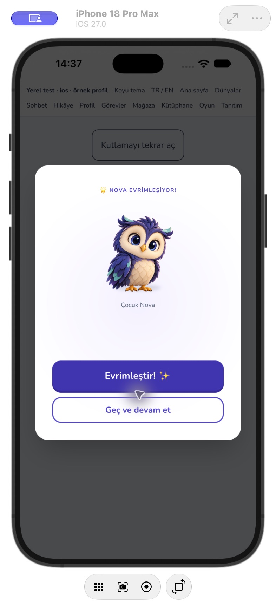
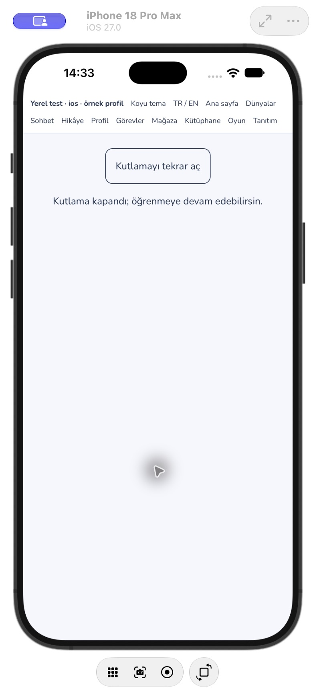
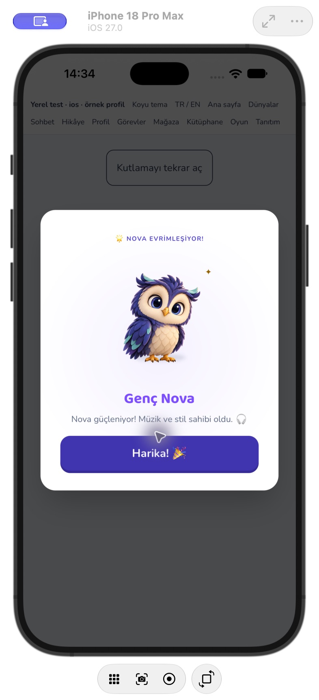

# Nova açılışı ve geçilebilir evrim kutlaması

25 Ekim 2026. Hikâye kataloğundan sonra görsel incelemedeki iki açık madde ele alındı. Bu ekleme tüm eski planların tamamlandığı anlamına gelmez.

## Değişiklikler

- Evrim kutlamasında ilk andan itibaren **Geç ve devam et / Skip and continue** var. Dönüşüm sırasında da kullanılabilir; normal bitişte mevcut **Harika!** eylemi korunur. Kapatmak yalnız kutlama katmanını kapatır; kazanılmış aşama veya ödül geri alınmaz.
- Her açılış kendi durumunu ve 1,2 saniyelik zamanlayıcısını taşır. Kapanınca veya aşamalar değişince eski zamanlayıcı temizlenir; yeniden açılınca eski sonuç görünmez. Kapanış anında katman kalkar.
- Hareket azaltma tercihinde dönüşüm beklemesi ve düğmelerin gecikmesi kalkar; parçacıklar ve yeni aşamanın karakter hareketi çalışmaz. Klavye odağı diyalogda tutulur, Escape kapatır ve odak önceki elemana döner.
- Aşama etiketi Nova'nın altında ortalanır.
- Android'deki 11 eski `splash.png` yerine tek XML yerleşimi ve mevcut `/nova/nova-idle.webp` kaynağının teknik PNG dışa aktarımı kullanılır. `scripts/exportAndroidSplash.py` yalnız yeniden boyutlandırır/pad ekler; yeni sanat üretmez, API kullanmaz. Kaynak: `android/app/src/main/res/drawable-nodpi/nova_splash.png`.
- Android 12+ ve uyumluluk açılış temasında mevcut yeni Nova adaptif ön planı açıkça bağlanır. Açılış zemini iOS storyboard'uyla aynı `#F5F7FC`; eski/programatik açılışta Nova 192dp merkezde görünür. Sabit portre/yatay ekran PNG'leri kaldırıldığı için görüntü ekran oranına göre esnemez.

## Doğrulama ve sınırlar

- Evrim ve genel modal entegrasyonu: **11 test / 2 dosya geçti**. İlk anda ve dönüşüm sırasında geçme, normal bitiş, tekrar açma, aşama değişimi, hareket azaltma, Tab/Escape ve odak dönüşü doğrulandı. Önceki koşullu bitiş testi artık koşulsuz beklenti içerir.
- Lint, TypeScript derleme kontrolü, kaynak Prettier kontrolü ve üretim derlemesi geçti. iOS ve Android web kaynakları eşitlendi. Android `:app:assembleDebug` başarılı; paket test emülatörüne veri silmeden kuruldu ve `MainActivity` başlatıldı.
- iPhone 18 Pro Max / iOS 27'de ayrı `com.novalingo.visualqa` kabuğunda başlangıç, geçme sonrası katmanın kalkması, yeniden açma ve normal dönüşümün sonuç ekranı gerçek WKWebView içinde kontrol edildi. Yerel test görünümü sunucuya yazmaz. QA kabuğunun açılış katmanı için yalnız `/tmp` yapılandırmasında otomatik gizleme açıldı; ürünün `launchAutoHide: false` ayarı korunur.
- Android emülatör penceresi bilgisayar kontrol aracının uygulama listesinde tanınmadı; ekran görüntüsü/manuel görsel kontrol tamamlanmış sayılmaz. Kaynak derleme, APK kurma ve Activity başlatma bunun yerine tam görsel QA olarak sunulmaz.
- Gerçek hesap, satın alma, fiziksel cihaz, Android eski sürüm ve tam çevrimdışı senaryolar bu kontrolün kapsamı dışındadır. Mevcut büyük JS parçası/Gradle uyarıları sürer. Otomatik merge, canlı dağıtım veya mağaza başvurusu yapılmadı.

## Açık kalan görsel işler

Yeni ayrı düşünme/uyku/cesaret/konuşma ifadeleri, eski SVG hata yedeği, ödül/mağaza ikon birliği, küçük etiketlerin tam envanteri ve kapsamlı cihaz/çevrimdışı/satın alma doğrulaması hâlâ açık. Meshy modeli kullanıcının kararına göre hesapta kalır; indirme aboneliği satın alınmadı.
