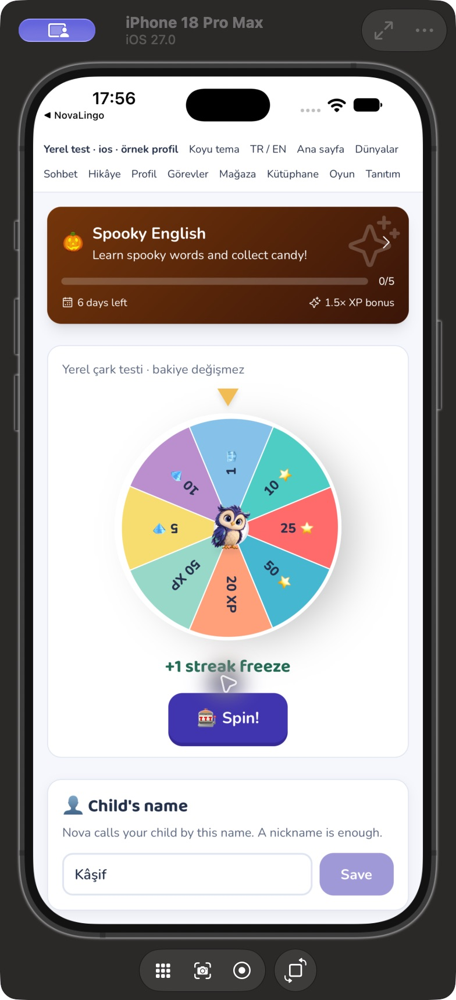
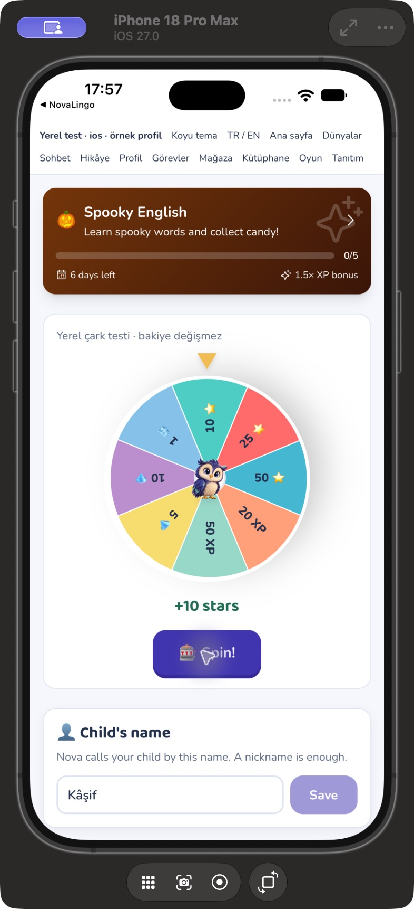
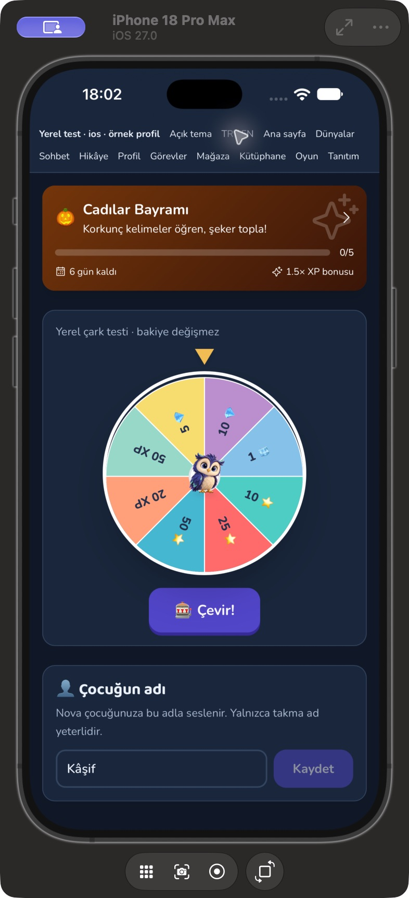
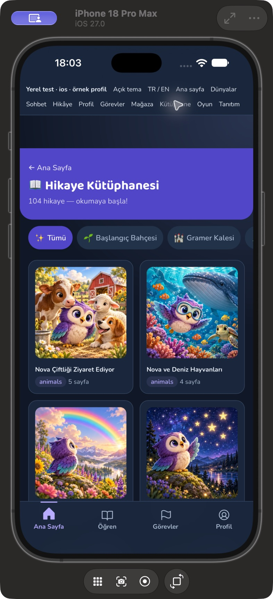

# NovaLingo — küçük etiketler ve tema devamı

25 Ekim 2026. Önceki ödül/mağaza ve hareket çalışmalarından sonra kalan küçük yazılar, etkinlik kartı ve belirli yardımcı metinlerin okunabilirliği ele alındı.

## Değişiklikler

- Hikâye kütüphanesindeki tema/sayfa etiketleri, sohbet üst etiketi, bölüm rozeti ve ipucu kalıpları 10px yerine 12px kullanır. Kütüphane dünya filtreleri en az 44px yüksekliktedir. Sohbetin kapatma eylemi 44px ve yerelleştirilmiş erişilebilir ada sahip; başlık metni büyürken iki kenar düğmesini itmez.
- Sohbet ipucu, dilbilgisi açıklaması ve konuşma sonucundaki kayıt hatası metinlerinde açık turuncu/sarı yazı yerine açık/koyu moddaki ortak `reward-ink` kullanılır. İçerik, ipucu gösterme, skor ve kaydetme mantığı değişmez.
- Ebeveynin çocuk adı alanındaki sabit beyaz zemin kaldırıldı. Alan zemin, sınır, yazı ve odak rengini tema tokenlarından alır. Profil adı bu QA sırasında kaydedilmedi.
- Ana ekrandaki etkinlik kartı ve etkinlik sayfası aynı koyu kaplamalı gradyanı paylaşır. Başlık, açıklama ve XP metni seçili dili izler; yaklaşan etkinlik önizlemesi de yerelleşir. Aktif kart gerçek bir düğmedir; odak/klavye ile kullanılabilir ve aynı etkinlik rotasını açar. Bilgi satırı dar alanda sarılır; ilerleme çizgisi koyu modda da beyazdır ve genişliği %0–100 aralığında kalır.
- Günlük çarkta beyaz 8px yazı yerine koyu, SVG'de 12 birimlik kalın yazı var. Çark kapsayıcıya küçülebilir; merkezde ortak Nova kullanılır. 256px çarkta iç SVG'nin 248px genişliğinde 12 birim yazı yaklaşık 14,9 CSS px; 240px alanda yaklaşık 13,9px olur. SVG dekoratif kalırken ödüller ekran okuyucuya bir liste ve sonuç `status` alanıyla metin olarak verilir.
- **Çarkta seri dondurma ödülünün elmas gibi gösterilmesi düzeltildi.** Sonuç, XP/yıldız/elmas/seri dondurma için gerçek birimi seçili dilde yazar; diğer türler genel ödül olarak açıklanır.
- **Aynı çark yeniden çevrildiğinde önceki açı yüzünden yanlış dilimde durması düzeltildi.** Son açı mevcut dönüşe göre hesaplanır. Boş veya kullanılamayan çark ödül isteği yapmaz; reddedilen istekte sahte sonuç üretilmez. Sunucu ödülü, miktarı, ağırlıkları, günlük limit ve bakiye güncellemesi değiştirilmedi.

## Ölçüm ve doğrulama

- Altı etkinliğin her gradyanı 101 noktada örneklendi (**606 nokta**). Beyaz yazı kontrastı taban üzerinde en az **7,79:1**, kartın en açık `white/20` bilgi rozeti üzerinde **4,73:1**. Çarktaki sekiz rengin koyu yazıyla en düşük kontrastı **4,66:1**. Bunlar tanımlı renk çiftlerinin sRGB hesaplarıdır; tüm ekran/çocuk kullanılabilirliği denetimi değildir.
- **77 test / 9 dosya:** etkinlik kartı yönlendirmesi, aktif/yaklaşan EN içerik ve boş durum; altı etkinlik kontrastı; çarkın gerçek SVG renk kontrastı, ödül birimleri, iki ardışık duruşun göstergeyle hizası, boş/kullanılamayan çark ve başarısız istek; mevcut kütüphane, genel modal, konuşma, XP sayacı ve altı tema kombinasyonu regresyonları.
- Lint, `tsc -b`, kaynak biçim kontrolü ve üretim web derlemesi başarılı. iOS/Android kaynakları eşitlendi; Xcode simülatör ve Android `assembleDebug` derlemeleri başarılı. Mevcut büyük JS parçası/Gradle sürüm uyarıları bu çalışmanın hatası olarak değerlendirilmez.
- Gerçek iPhone 18 Pro Max / iOS 27 WKWebView QA kabuğunda, ilk dönüşte seri dondurma ve ikinci dönüşte 10 yıldız örnekleri doğru üst dilim ve sonuç metniyle görüldü. Bu test `com.novalingo.visualqa` içinde sabit örnek yanıt döndürür; gerçek bakiye/ödül servisine yazmaz ve kullanıcıya günlük limiti aşarak iki ödül kazandırmaz.
- Açık/EN ve koyu/TR etkinlik kartı, çark ve çocuk adı alanı görüldü. Koyu kütüphanede yeni etiket boyutları ve filtreler kontrol edildi. Tema/dil test düğmeleri yalnız geliştirme fixture'ındadır; üretim akışına teknik QA alanı eklenmedi.

## Kalan sınırlar

Android manuel görünüm ve fiziksel/düşük donanım doğrulaması açık. Her metin/arka plan/etkileşim durumunun kontrastı ve ekran okuyucu ile tam tur test edilmiş sayılmaz. Gerçek ödül satın alma, hesap güncelleme, ücretli işlem, canlı dağıtım veya mağaza başvurusu yapılmaz. Önceki görseller ve hikâye iç çizimleri korunur.
