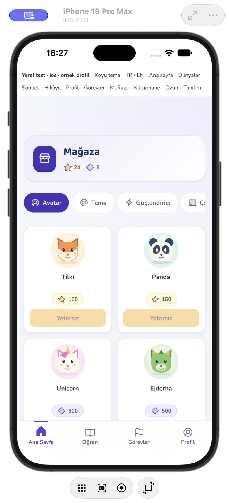
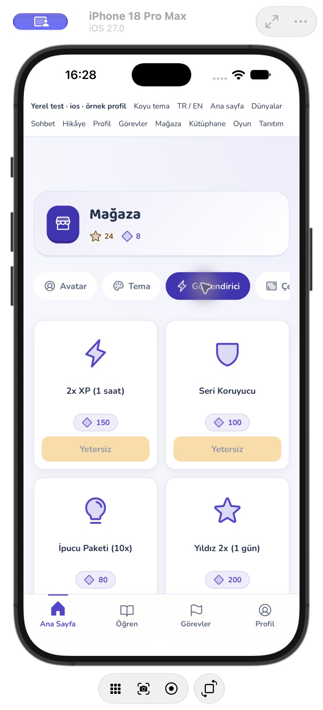
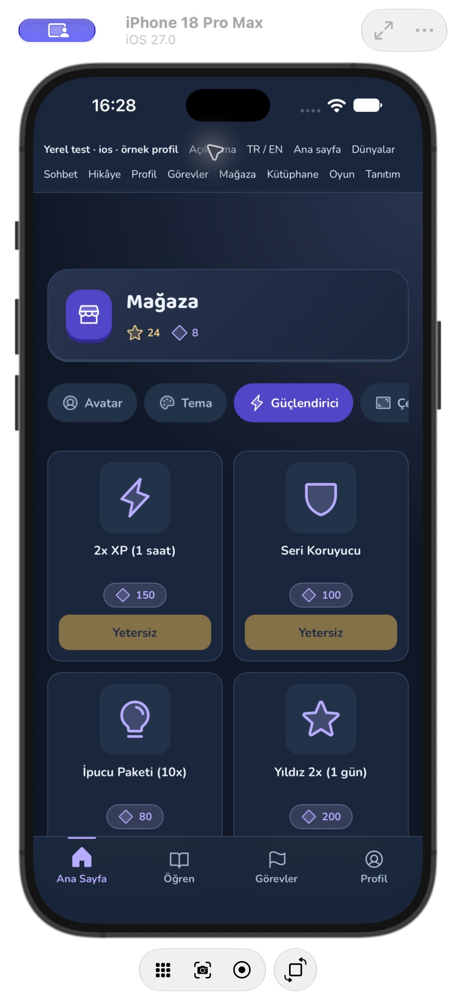
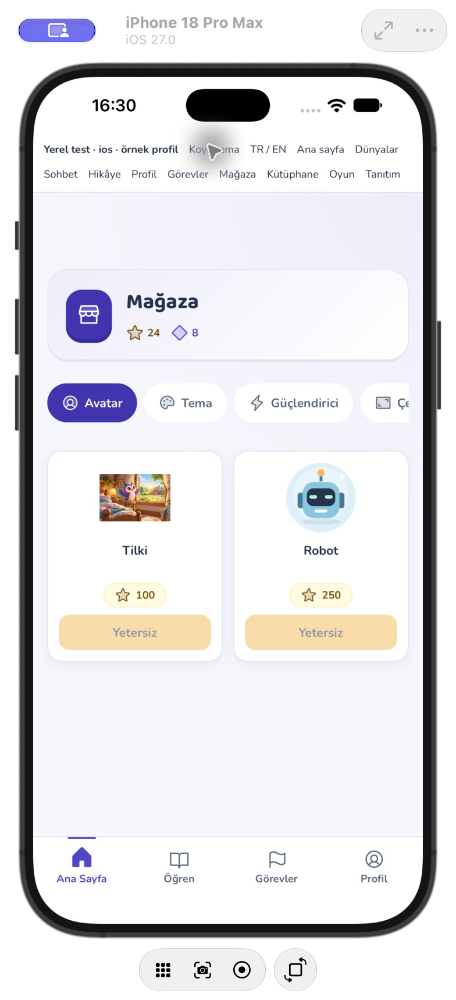
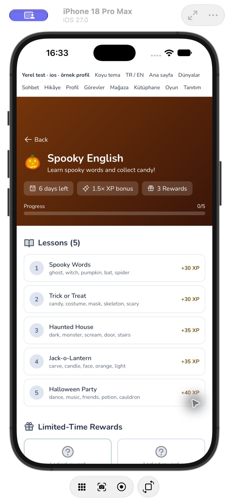
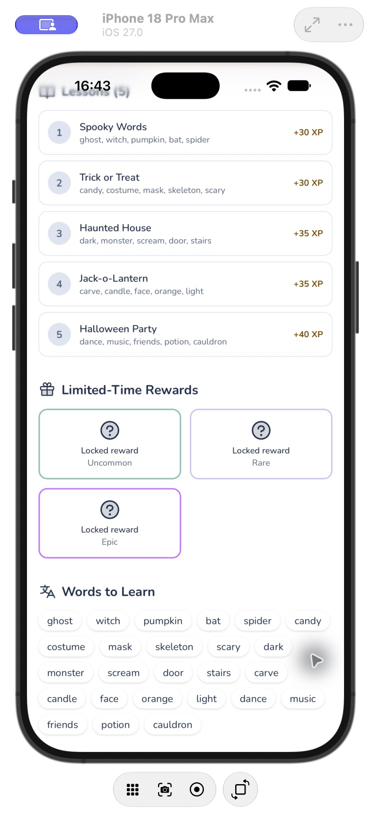
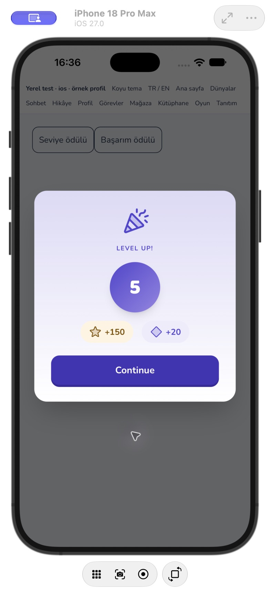
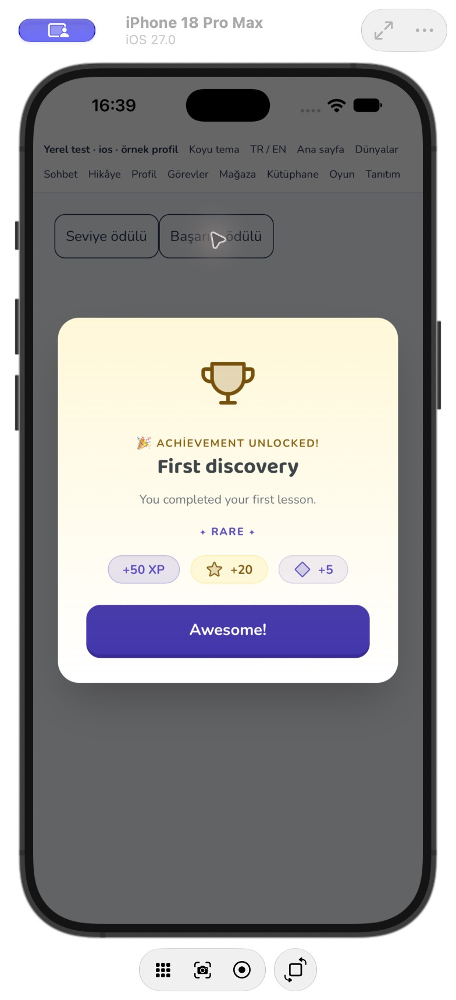

# Mağaza ve ödül görselleri / okunabilirlik

25 Ekim 2026. Nova ifade setinden sonra mağaza, koleksiyon filtreleri, ödül kutlamaları ve etkinlik etiketleri ortak tasarıma uyarlandı.

## Değişiklikler

- Mağaza kategorileri Phosphor duotone ikonları kullanır. Altı avatar ürünü profilin mevcut özgün `AvatarArtwork` çizimleriyle gösterilir; tema/güçlendirici/çerçeve/efekt/Nova ürünleri aynı ikon ailesinden semboller kullanır. Yeni ücretli görsel üretimi veya indirme yok.
- **Ürün resmi URL'sinin düz yazı olarak görünmesi düzeltildi.** `CatalogArtwork`, yerel veya HTTPS resmini gerçek `` olarak gösterir; yüklenmezse öğeye uygun vektör çizime döner. Yeni URL önceki başarısız URL'den bağımsız yüklenir. İçerikte anlam taşıyan eski emoji ve ülke bayrakları korunur. Sunucudan gelen ürün/başarım görselleri aynı davranışı kullanır.
- Yıldız/elmas simgeleri bakiyede, ürün fiyatında ve seviye/başarım ödüllerinde ortak `RewardIcon` bileşenine bağlandı. Para türü ekran okuyucuya metinle verilir; ikon dekoratiftir. Ürün adı kırpılmaz, satıra geçebilir. Fiyat, bakiye, satın alma çağrısı ve yetersiz bakiye kısıtı korunur. Bu çalışma gerçek satın alma servisini değiştirmez.
- Mağaza ve koleksiyon kategori düğmeleri en az 44px yükseklikte; seçili durumları `aria-pressed` ile açıklanır. Koleksiyon kategori/boş durum ve kilitli öğe arayüz ikonları yenilenir. Koleksiyonun hayvan/bayrak/yemek gibi **içerik çizimlerinin tamamı yeniden üretilmedi**.
- Ortak küçük Badge, Text.overline, avatar seviye etiketi ve bakiye farkları 8–10px yerine en az 12px kullanır. Bu ortak bileşen değişikliğidir; her ekrandaki özel etiketin tam envanteri tamamlandı iddiası değildir.
- Etkinlikte 10px nadirlik etiketleri 12px ve TR/EN karşılıklarıyla gösterilir. Telefonlarda ödüller iki sütuna geçer; bilgi rozetleri sarılır. Kilitli ders/ödül yazısını solduran genel opaklık kaldırılır. Başlık, bonus ve ders adları dil seçimini izler; bölüm ikonları aynı aileye geçer.
- Altı etkinliğin özgün renk gradyanı koyu kaplamayla korunur. 12 uç rengin sRGB hesabında beyaz başlık kontrastı en az **7,79:1**, yarı saydam bilgi rozeti üstündeki beyaz yazı en az **5,34:1**. Hesap yalnız bu başlık/rozet çiftleri içindir; tüm arayüzün kontrast denetimi değildir.
- **Başka etkinliğin ödül/tamamlanma bilgisinin yanlış ekranda görünmesi düzeltildi.** Aktif etkinlikle açılan sayfa eşleşmiyorsa aktif etkinliğin kazanılmış öğeleri, bitmiş dersleri ve tebrik alanı taşınmaz.
- Seviye/başarım kutlamasının sabit Türkçe düğmeleri ve destek yazısı yerelleştirildi; başarım başlık/açıklaması İngilizce alanı izler.

## Doğrulama

- **62 test / 9 dosya geçti**: gerçek ürün resmi, yükleme hatası, yeni URL'ye geçme, içerik emojisi/bayrağı; varsayılan vektör avatar; mevcut satın alma parametreleri ve yetersiz bakiye engeli; kategori değişimi; etkinlikler arası ödül/tamamlanma sızıntısı; EN adlar; mevcut para, seviye, genel modal ve ortak tipografi/rozet/avatar testleri.
- Lint, `tsc -b`, kaynak biçim kontrolü ve üretim derlemesi geçti. iOS ve Android web kaynakları eşitlendi; Xcode simülatör ve Android `assembleDebug` derlemeleri başarılı.
- iPhone 18 Pro Max / iOS 27 ayrı, sunucuya yazmayan QA kabuğunda: avatar ve güçlendirici mağazası; açık/koyu tema; sunucu biçimindeki örnek resim ve bilerek bozuk resmin yedeği; EN etkinlik başlığı/dersleri, ödül kartlarına kaydırma; seviye ve başarım ödüllerini açma/kapatma doğrulandı. Örnek katalog resmi olarak mevcut bir hikâye sahnesi yalnız yerel fixture'da kullanılır, gerçek ürün kataloğuna yazılmaz.
- Yerel tarayıcı kontrolü Work ayarlarında kapalıydı; bu tur tarayıcı/dar 320px kontrolü yapılmış sayılmaz. Gerçek iOS simülatör kanıtı kullanıldı. Android manuel görsel kontrolü ve fiziksel cihaz hâlâ açık.
- Gerçek hesap bakiyesi, mağaza ödeme/Plus akışı veya canlı katalog değiştirilmedi; gerçek satın alma yapılmadı. Simülatörde normal uygulama paketi veri silmeden güncellenir. Otomatik merge, canlı dağıtım veya mağaza başvurusu yok.

## Kalanlar

İlk görsel incelemenin bütün maddeleri bitmiş sayılmaz. İleri karakter animasyonu/gaga senkronu, arka planda genel hareket durdurma, kalan özel küçük etiket/ikon taraması ve kapsamlı gerçek hesap/cihaz/çevrimdışı/satın alma testleri açık. Meshy modeli kullanıcının kararıyla hesapta kalır.
