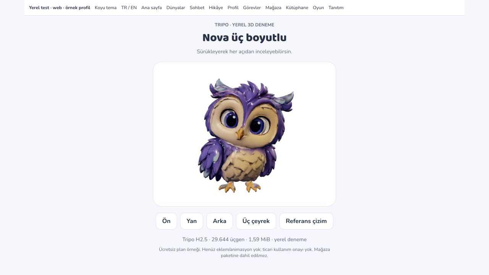
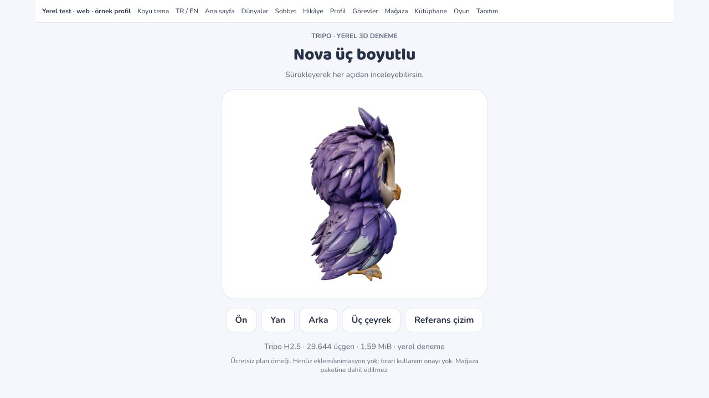
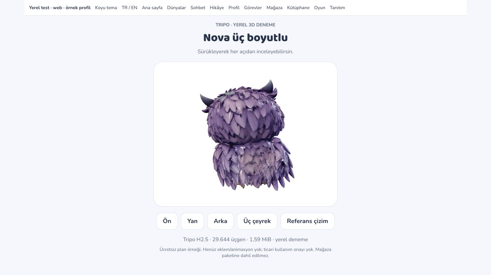
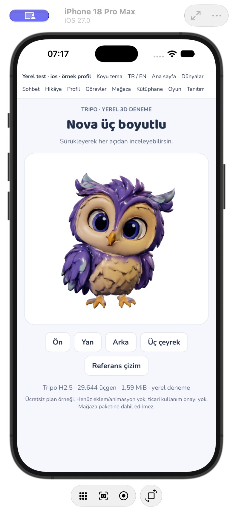
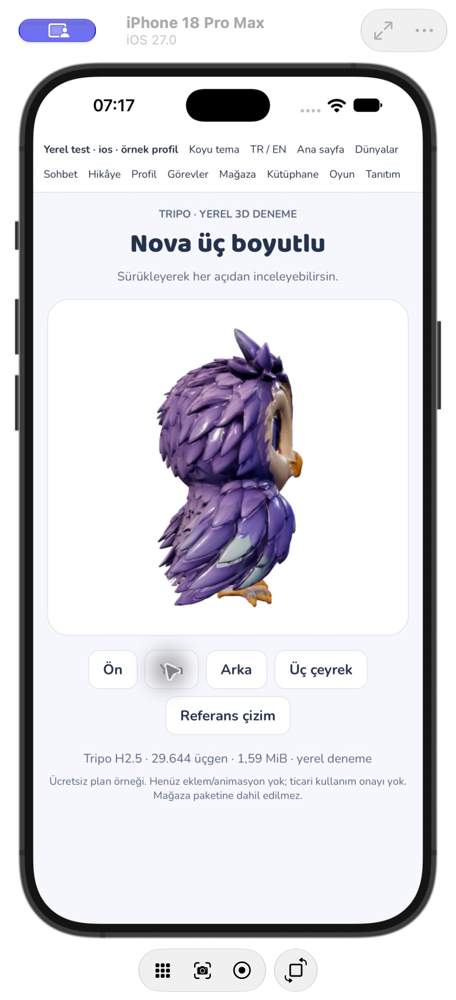
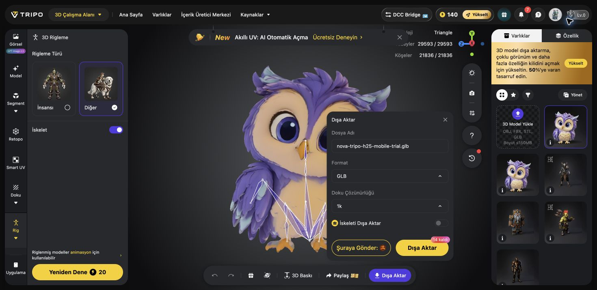
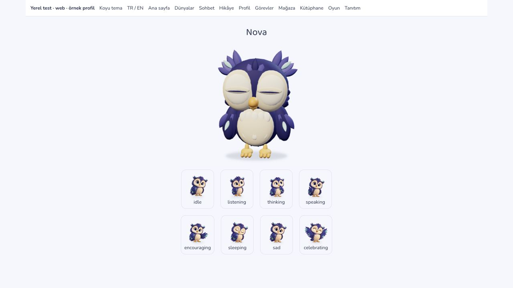

# Nova 3D — Tripo denemesi ve görüntüleme altyapısı

26 Ekim 2026. Kullanıcı gerçek 3D istedi; ardından Chrome'da açtığı Tripo AI'nin denenmesini istedi ve ücretsiz plandaki herkese açık model / hak koşulları açıklandıktan sonra **“Ücretsiz denemeyi yap”** diye onayladı. Bu kayıt çalışan bir yerel model denemesini anlatır; mağaza sürümüne ticari kullanım hakkı olmayan bir varlık eklenmez.

## Tripo sonucu

- Kullanıcının mevcut hesabında 200 ücretsiz kredi vardı. İndirilebilir **H2.5** modeli seçildi; onaylı `idle.webp` referansı yüklendi. Ekranda belirtilen **40 kredi** ile tek üretim yapıldı, **160 kredi** kaldı. Yeni üyelik veya para ödemesi yapılmadı.
- [Model hesabındaki sonuç](https://studio.tripo3d.ai/tr/workspace/generate/529481d4-4aad-4b3b-ad5d-185c17184120). GLB / 1K dokular seçilip indirme tamamlandı. Kaynak `/Users/onerozbey/Downloads/nova-tripo-h25-trial.glb`: **15.736.288 bayt, 501.774 üçgen, üç 1024×1024 JPEG doku**, tek mesh. **İskelet ve animasyon klibi yok.**
- Yerel glTF Transform / Meshoptimizer sadeleştirmesi: **1.667.004 bayt / 1,59 MiB, 29.644 üçgen**, tek çizim çağrısı. Geometri yaklaşık %94, dosya yaklaşık %89 küçüldü. Doku çözünürlüğü korunur. Sadeleştirme kayıplıdır; ön/yan/arka siluet örnek olarak incelendi, her yüzeyin eşitliği iddia edilmez. [Boyutlar, kaynak/hash ve işlem kaydı](2026-10-26-tripo-model-trial.json).
- Yerel deneme dosyaları `e2e/.local-assets/` altındadır ve `.gitignore` ile hariçtir; `public/` içinde değildir. `visual-preview.html?view=tripo` geliştirici girişinden yüklenir. Üretim derlemesi bu HTML'yi veya Tripo varlığını içermez. Başka makinede dosyalar indirilmeden bu yerel ekran model bulamaz.
- GLB tarayıcıda çalıştı. iOS WKWebView'de tek dosyalı doku açılışı takıldığı için aynı model harici `.gltf` + `.bin` + JPEG dosyalarıyla yerel sunucudan yüklendi. Bu sürüm iPhone 18 Pro Max / iOS 27 QA kabuğunda açıldı; ön ve yan görünüş düğmeleri çalıştı. Bu kök nedenin bütün Safari sürümlerinde aynı olduğu iddia edilmez.
- Ön/yan/arka/üç çeyrek düğmeleri, sürükleyerek inceleme ve çizim referansına dönüş vardır. Viewer talep üzerine çizer; sonsuz render döngüsü yoktur. Arka planda çizim durur, çıkarken renderer/kontrol/geometri/malzeme/doku temizlenir. Açık/koyu web görünümü kontrol edildi.

## İskeletleme ve haklar

Kullanıcı **“20 ücretsiz krediyi kullan”** diye onayladıktan sonra “Rig → Diğer” türünde tek iskeletleme denemesi yapıldı. Kaynak 501.774 üçgen otomatik rig sınırını aştığından ek ücretli retopoloji açılmadı; yerelde hafifletilmiş GLB tekrar yüklendi, ön yönü Y=90° ile ayarlandı. Tripo içe aktarımında **29.593 yüz / 21.836 köşe** raporlandı. [İskeletli sonuç](https://studio.tripo3d.ai/tr/workspace/rigging/c071bd73-7cc8-484d-b1e8-c0dab40ced54) hesapta hazır; **20 kredi** kullanıldı, toplam **60 kredi** harcanmış oldu ve **140 kredi** kaldı.

Sonuçta ekranda kemikler görünür ve servis “Riglenmiş modeller animasyon için kullanılabilir” der. Ancak GLB dışa aktarma penceresindeki **“İskeleti Dışa Aktar” anahtarı kapalı ve devre dışı**; üzerindeki kilit denetimi abonelik planı ekranını açtı. Plan satın alınmadı, ağdan veya önizlemeden korumalı rig dosyası çıkarılmadı. İndirilen yerel Tripo dosyası hâlâ **iskeletsiz** sürümdür. İskeletin yerel deformasyon/klip kalitesi test edilemedi. Yeniden deneme veya ilave 20 kredi animasyon üretimi yapılmadı.

Resmi sayfalar çelişiyor: [fiyat/kredi rehberi](https://www.tripo3d.ai/product-doc/getting-started/pricing-credits) ücretsiz kullanım için atıfla ticari kullanımdan bahsederken [ticari haklar yardım sayfası](https://www.tripo3d.ai/help/privacy-policy/how-to-use-tripo-models-commercially) ücretsiz planda ticari hakkın verilmediğini söyler; [asıl koşullar §5.2.1](https://www.tripo3d.ai/terms) ücretsiz giriş/çıktılar üzerinde geniş hak iddiası içerir. Bu yüzden çıktı yalnız kullanıcının onayladığı yerel deneme için tutulur. Ücretli plana geçmenin daha önce üretilmiş bu dosyanın hakkını geriye dönük düzelttiği varsayılmaz; ticari hak yazılı olarak netleştirilmeli veya uygun koşullarla yeniden üretilmelidir.

## Uygulamadaki 3D altyapı ve özgün kontrol modeli

Meshy GLB indirmesi hâlâ üyelik istiyor; paywall aşılmadı. Dışa aktarıma bağlı kalmadan görüntüleme/hareket altyapısını test etmek için ayrıca **yerel kodla özgün bir baykuş modeli** üretildi. Bu Tripo ya da Meshy modelinden elde edilmedi ve nihai sanat onayı almış sayılmaz.

- Three.js 0.186.1, ayrı tembel yüklenen görüntüleyici. `NovaCharacter renderMode="3d"` ile açılır. Onaylı raster görseller varsayılan kalır; baş/kanat/göz/gaga animasyonlarının Tripo mesh'ine aktarılmış olduğu iddia edilmez.
- Özgün model 21.652 üçgen / 38 mesh içerir. Ayrı pivotlar: gövde, baş, sağ/sol kanat, göz/bakış, kapaklar ve alt/üst gaga. Bu parça/pivot rig'idir; tek yüzey üstünde ağırlıklı kemik rig'i değildir. Ayaklar nefes ve kanat hareketinde zeminde kalır.
- Göz kırpma, uyku, dinleme/düşünme eğimi, destek/kutlama kanat pozu ve bakış vardır. Gaga yalnız gerçek konuşma servisinin oynatma durumu açıkken hareket eder; bu **fonem veya ses şiddeti eşlemesi değildir**. Hareket azaltma, belge/native arka plan ve ekran dışı duruş çizim döngüsünü durdurur; hedef en fazla 30fps, piksel oranı en fazla 1,5'tir. Bunlar ölçülmüş cihaz FPS garantisi değildir.
- WebGL2 yoksa, yükleme başarısızsa veya bağlam kaybolursa mevcut Nova görseli kalır/geri gelir. Çıkışta listener/observer/frame/geometri/malzemeler temizlenir. Küçük listelerde yeni GPU bağlamları otomatik açılmaz.
- `scripts/export-nova-3d.mjs` kaynak modeli tekrar üretir. **798.648 bayt** GLB ve yedi yerel klip (`Idle`, `Listen`, `Think`, `Speak`, `Celebrate`, `Encourage`, `Sleep`) `e2e/assets/nova-original-v1.glb` altında yer alır. GLTFLoader ile yeniden açılıp klipler ve baş/gaga pivotları doğrulandı. Üretim model varlığı değildir.

## Doğrulama ve açık sınır

Son model/görüntüleyici regresyon setinde **53 test / 7 dosya** geçti: model geometrisi/indisler/bütçe, zemin, deterministik poz, oynatma-gaga kapısı, kapaklar, kaynak temizliği, native/belge arka plan, ekran dışı duruş, azaltılmış hareket, WebGL kaybı/yokluğu; önceki Nova/evolution/world/conversation davranışları. Son ek test, büyük Nova'nın varsayılan onaylı görsel olarak kaldığını doğrular. TypeScript, tam lint, değişen kaynakların biçim kontrolü ve üretim derlemesi geçti. Ayrı iOS QA kabuğu yerel denemeyi gösterir; normal kullanıcı profili veya hesapta yazma yapılmaz.

Tripo rig dosyasının indirilmesi ve yerel deformasyon testi, fonem eşlemesi, özgün modelin nihai sanat onayı, ticari lisans, fiziksel/düşük donanım performansı ve Android manuel WebGL testi açık. Bu çalışma otomatik merge, canlı yayın, mağaza yüklemesi veya ücretli üyelik başlatmaz.
