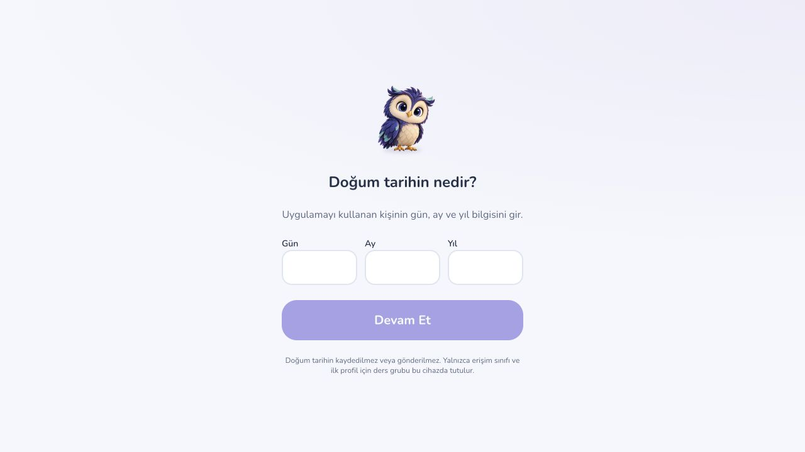
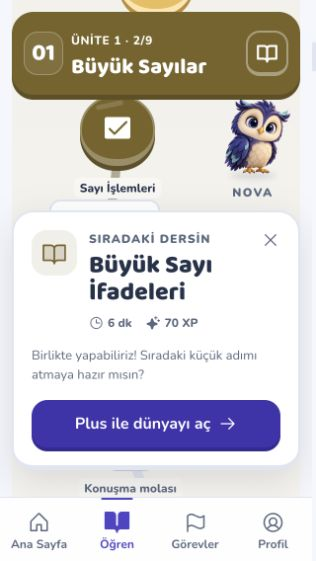
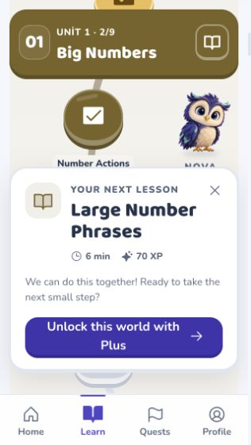
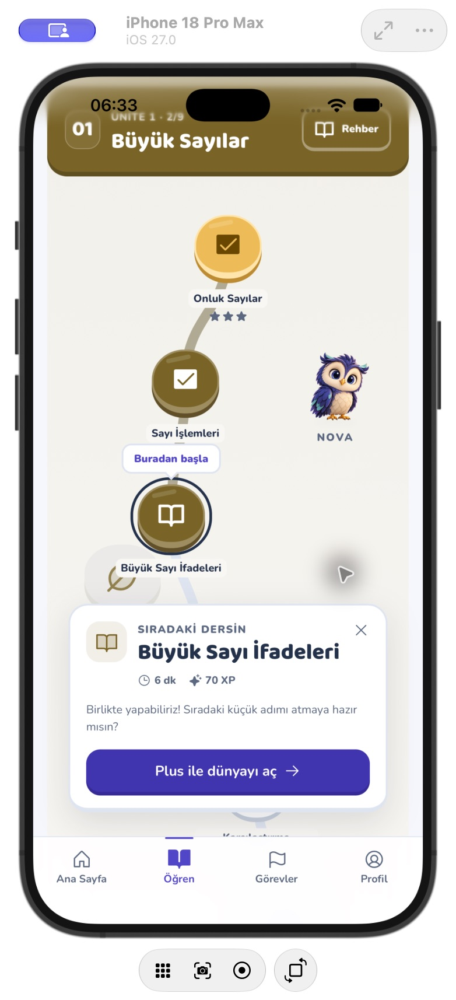

# NovaLingo — çevrimdışı açılış ve küçük ekran ders kartı

26 Ekim 2026. Önceki görseller korunarak iki somut kullanım sorunu düzeltildi. Bu belge web uygulamasının açılış dosyalarını ve ders seçme kartını kapsar; bütün oyunun çevrimdışı çalıştığı iddia edilmez.

## Çevrimdışı web açılışı

Eski servis çalışanı HTML'yi kurulumda saklıyor, JavaScript'i yalnız ziyaret edildikçe önbelleğe alıyordu. Bu yüzden daha önce indirilmemiş bir ekranın kodu bağlantı kesilince bulunamayabiliyordu.

- Vite artık derleme sonunda HTML, manifest, bütün JS/CSS parçaları ve yerel fontlardan bir liste ve içerik sürümü üretir. Son filtreli mobil derlemede **94 dosya / 79 JS / 7.437.192 bayt (7,09 MiB)** vardır. Hem normal public kopyalama hem `VITE_BUNDLE_TTS_AUDIO=false` yolu kontrol edildi. Hikâye/dünya görsellerinin tamamı ve TTS kataloğu bu ilk listeye eklenmez.
- Servis çalışanı ancak listenin tamamı indirildiğinde etkinleşir. Eksik indirme mevcut çalışan sürümü değiştirmez. Güncellemede bir önceki tamamlanmış dosya grubu açık sekmelerin eski hash'li parçaları için tutulur; başarısız kurulumun boş önbelleği önceki sürüm sanılmaz. Yalnız kendi eski açılış önbellekleri temizlenir.
- Gezinme HTML'si aynı sürümün hazır koduyla eşleşir. Manifest ve fontlar da çevrimdışı kullanılabilir. Daha önce ziyaret edilmiş aynı kaynaklı genel görseller korunur; henüz açılmamış bir resim indirilmiş sayılmaz ve bileşenin mevcut gradyan/Nova yedeği devreye girer.
- Ses kaydı yazımı/200 kayıt sınırı servis çalışanının ömrü boyunca tamamlanır; depolama kotası hatası çalmayı engellemez. Ses aralık istekleri normal ağa gider. API, kimlik doğrulama başlıklı, farklı kaynaklı veya GET olmayan istekler yakalanmaz. Özel hesap verileri bu genel dosya önbelleğine eklenmez.
- Native iOS/Android servis çalışanını açmaz; kendi paketindeki dosyaları kullanmayı sürdürür. Bu tur native kayıt davranışı değiştirilmedi.

### Gerçek tarayıcı kontrolü

Son üretim paketi geçici `127.0.0.1:4175` sunucusundan açıldı: **98 başarılı istek, sıfır 404**, servis çalışanı ve tüm açılış parçaları indirildi. Sonra yalnız bu test sunucusu kapatıldı; bağlantı denemesi `000 / connection refused` döndü. Tarayıcıda yeniden yükleme ve `/world/w12` adresine yeni gezinme yapıldığında uygulamanın yaş kapısı yeniden çizildi. Doğum tarihi girilmedi, yaş kapısı geçilmedi, gerçek hesapta işlem yapılmadı. Bu, sunucu erişimi olmadan üretim uygulamasının açılışının çalıştığının kanıtıdır; giriş yapılmış dünyanın veya satın almanın çevrimdışı tamamlandığının kanıtı değildir. Önceki üretim derlemesiyle aynı deney 4174 üzerinde de başarılıydı.

İlk başarılı çevrimiçi kurulum ve tarayıcının depolamayı koruması gerekir. İlk kez internetsiz gelen kullanıcı, tüm resim/ses kataloğu, gerçek hesap eşitleme, ödeme, fiziksel düşük donanım ve tam çevrimdışı oyun akışı ayrıca doğrulanmalıdır. Birden fazla eski dağıtımı atlamış açık sekmelerin bütün sürümleri süresiz tutulmaz.

## Küçük ekranda ders kartı

320×568 tarayıcı görünümünde “Kaldığım yere git” sonrasında kartın başlatma düğmesi **y=564–612** aralığında kalıyordu; alt menü **y=503** itibarıyla üstünü kapatıyordu. 768px altındaki ekranlarda kart artık menü ve güvenli alanın üstünde sabitlenir. Ekran yüksekliğine göre sınırlandırılır; uzun içerik kendi içinde kayar. Masaüstündeki yol düğümüne bağlı yerleşim korunur.

- Aynı 320×568 görünümünde düzeltilmiş düğme **y=405–453**, kartın altı **y=476**, menünün üstü **y=503** olarak ölçüldü. Belgenin genişliği ve kaydırma genişliği eşit: **316px** (320px dış görünümün 4px kaydırma çubuğu dışında). Yatay taşma yok.
- TR ve EN metinleri gerçek tarayıcıda kontrol edildi. Escape kartı kapatıp odağı seçilen ders durağına geri getirir. “Kaldığım yere git” tekrar doğru dersi açar; Plus kilidi korunur. Bunlar gerçek hesaba yazmayan yerel örnek profildir.
- Gerçek iPhone 18 Pro Max / iOS 27 WKWebView QA kabuğunda devam etme eylemi ve menünün üstündeki kart kontrol edildi. Native QA kabuğu yerel Vite örnek profilini yükler; bu test gerçek satın alma değildir. Normal uygulamanın yeniden derlenen paketi verileri silinmeden simülatöre kuruldu.

## Doğrulama

- **49 test / 5 dosya**: servis çalışanı, çevrimdışı açılış, dünya haritası/Plus/günlük limit, yol modeli ve dünya görseli. Son servis çalışanı güçlendirmesi sonrasında ilgili **16 test / 2 dosya** yeniden geçti. Başarısız kurulum, önceki sürümün korunması, ziyaret edilmemiş lazy kod, manifest, eksik görsel, ses kotası ve özel isteklere dokunulmaması kapsanır.
- Lint, TypeScript/üretim web derlemesi ve değişen dosyaların biçim kontrolü geçti. Normal ve TTS'siz filtreli derlemelerin liste dosyaları diskte mevcut ve yer tutucu yerine yazılmıştır.
- Capacitor iOS/Android eşitlemesi, Xcode simülatör derlemesi ve Android `assembleDebug` geçti. Android manuel görsel testi yapılmadı. Mevcut font çözümleme/büyük JS parçası ve Gradle ileri sürüm uyarıları bu turda yeni hata değildir.
- Gerçek 3D/rig ve sesle eşleşen gaga animasyonu önceki kullanıcı kararıyla ertelenmiş durumda. Bu değişiklikler için canlı yayın, otomatik merge veya mağaza yüklemesi yapılmadı.
