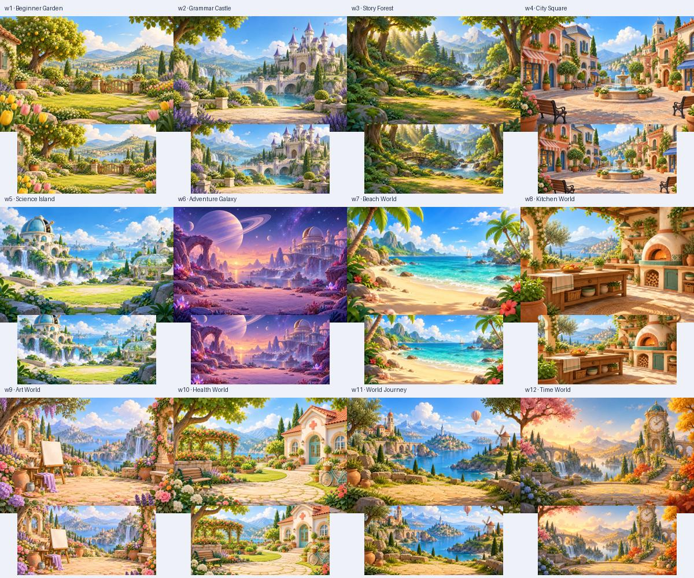
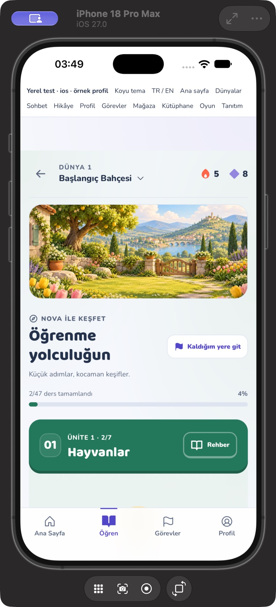
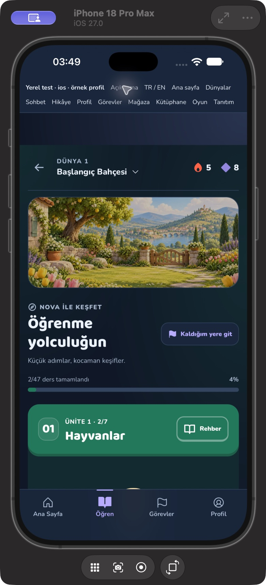
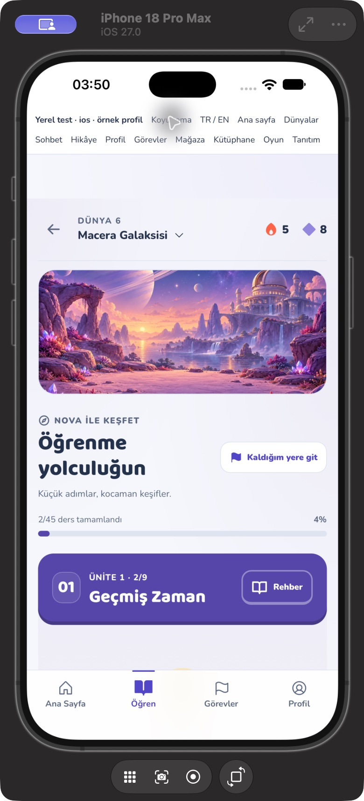
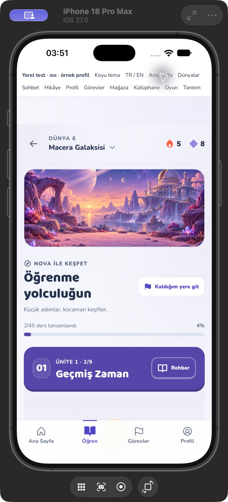
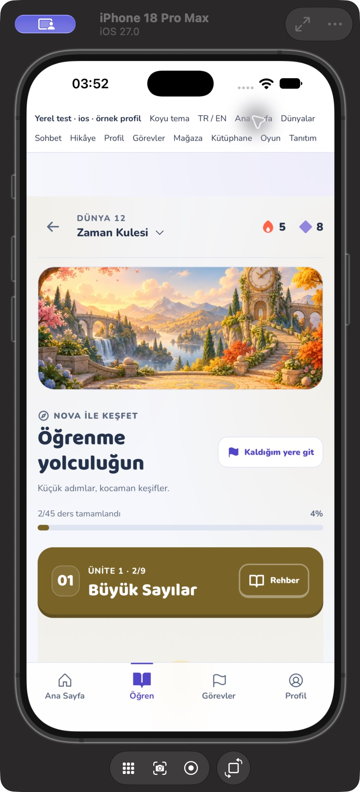
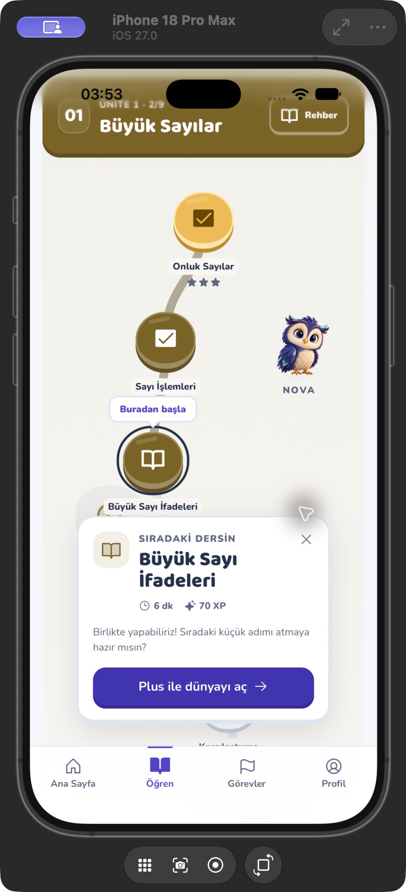

# NovaLingo — dünya sahneleri ve iOS şifreleme beyanı

26 Ekim 2026. On iki dünyanın her biri için ayrı çevre çizimi hazırlandı. Önceki turdan kalan küçük etiket/etkinlik kartı/çark düzeltmeleri [okunabilirlik kaydındadır](2026-10-25-readability-followup.md).

## Dünya görselleri

- Başlangıç Bahçesi, Gramer Kalesi, Hikâye Ormanı, Şehir Meydanı, Bilim Adası, Macera Galaksisi, Tatil Limanı, Lezzet Mutfağı, Yaratıcı Stüdyo, Sağlık Merkezi, Dünya Kaşifleri ve Zaman Kulesi için **12 ayrı resim** var. Eski hikâye kapağı kopyalanmadı; her ortam ayrı ImageGen çağrısıyla üretildi. Gerçek zamanlı 3D veya video değildir.
- Proje dosyaları: `public/scenes/worlds-v1/w1.webp` … `w12.webp`. Her biri **1200×800**, toplam **2.260.886 bayt / 2,16 MiB**. Yerleşik `image_gen` kullanıldı; CLI/API anahtarı veya Meshy dışa aktarma/abonelik işlemi yok. PNG kaynakları üretim klasöründe korunur; istemler, kaynak adları, SHA-256 ve boyutlar [üretim kaydında](2026-10-26-world-scene-prompts.json).
- Harita üstünde sabit yükseklik ayrılmış dekoratif çevre sahnesi gösterilir; ders yazıları ve yol düğümleri okunur tema yüzeylerinde kalır. Bütün uzun yolu aynı resimle tekrar tekrar kaplamak yerine dünyanın kimliği girişte görünür. Ana ekranın mevcut dünya/Nova kartı da aynı dünyanın sahnesini kullanır.
- Yalnız mevcut dünya resmi istenir; üretim kodu on iki resmin tamamını önceden yüklemez. Yerel uygulama paketine hepsi dahil edilir; webde daha önce açılan WebP'ler mevcut servis çalışanı önbelleğinden yararlanır. Kapsamlı çevrimdışı ilk açılış testi yapılmış sayılmaz.
- Görsel eksik veya bozuksa sabit çerçeve sakin bir gradyan olarak kalır. Ders/ana ekran eylemleri görüntünün indirilmesini beklemez. Dünya değiştirilince hata durumu sıfırlanır; geri dönülen sahne yeniden denenir. Dekoratif resimler ekran okuyucuya gereksiz içerik olarak okunmaz.
- Açık/koyu mod aynı resmi kullanır; koyu modda parlaklık/doygunluk azaltılır. Yazı resmin üstüne taşınmaz. Dünya yolunda CSS'de kalan 10–11px yardımcı etiketler de 12px'e çıkarıldı.

## iOS şifreleme beyanı

`ios/App/App/Info.plist` içine Boolean **`ITSAppUsesNonExemptEncryption = false`** eklendi. Bu anahtar “şifreleme hiç yok” anlamına gelmez; uygulamanın muaf olmayan şifreleme kullanmadığını beyan eder. İncelenen mevcut pakette ağ bağlantıları HTTPS/TLS üzerinden; Firebase/Google/Apple kimlik doğrulaması platform servislerini kullanır. Uygulamada özel AES/RSA/şifreli mesajlaşma/VPN veya bir şifreleme motoru bulunmadı. Web Crypto kullanımları rastgele kimlik/sayı ve SHA-256 oyun özeti; iOS AppAuth tarafında OS random/SHA-256 PKCE, Google tarafında OS Keychain kullanımı görüldü. Bunlar kullanıcıya özel kriptografi ürünü sunmaz.

Apple, yalnız muaf şifreleme kullanan uygulama ve bağlı kütüphaneler için bu değerin `NO` olmasını, alan bulunmazsa her yüklemede anket açılacağını açıklar. [Apple anahtar belgesi](https://developer.apple.com/documentation/bundleresources/information-property-list/itsappusesnonexemptencryption), [OS şifrelemesinin muaf kullanım açıklaması](https://developer.apple.com/documentation/security/complying-with-encryption-export-regulations).

Beyan **bu değişikliği içeren yeni build yüklendiğinde** App Store Connect'e ulaşır; önceki yüklenmiş build'in beyanını geriye dönük değiştirmez. Yeni özel şifreleme veya SDK eklendiğinde sınıflandırma tekrar kontrol edilmelidir. `ITSEncryptionExportComplianceCode` uydurulmadı; mağazaya paket gönderimi yapılmadı.

## Doğrulama ve sınırlar

- **112 test / 13 dosya** geçti: yeni sahnelerin benzersiz ve güvenli eşlenmesi, yalnız mevcut sahnenin yüklenmesi, bozuk resimden sonraki dünya/geri dönüş toparlanması, ana ekran eylemlerinin resim hatasında çalışması; dünya/Plus/günlük limit/rehber/ilerleme regresyonları; önceki okunabilirlik/etkinlik/çark ve PWA testleri.
- On iki WebP dosyası dekoderle açıldı; 1200×800 çözünürlük ve ayrı SHA-256 değerleri kontrol edildi. Tam resimler ve 2:1 merkez kırpımları ortak görsel tabloda incelendi.
- Lint, `tsc -b`, kaynak biçim kontrolü ve üretim web derlemesi başarılı. Capacitor iOS/Android kaynak eşitlemesi, Xcode simülatör ve Android `assembleDebug` derlemeleri geçti. Kaynak, dist, iOS/Android web dizinleri, derlenen iOS uygulaması ve APK içindeki 12 sahnenin hash'leri birebir eşleşti.
- Kaynak plist `plutil -lint` kontrolünden geçti. **Derlenmiş iOS App.app/Info.plist** içindeki anahtar ayrıca okundu: Boolean `false`. Normal uygulamanın yeni paketi simülatöre kullanıcı verisi silmeden kuruldu. İmzalı Release arşivi/IPA veya App Store Connect yüklemesi bu doğrulamanın parçası değildir.
- iOS QA: Gerçek iPhone 18 Pro Max / iOS 27 WKWebView içinde Başlangıç Bahçesi haritada açık/koyu modda; Macera Galaksisi haritada ve Nova ana ekran kartında; Zaman Kulesi haritada kontrol edildi. Zaman Kulesi “Kaldığım yere git” eylemi doğru derse kaydırıp bilgi kartını açtı; Plus kilidi görünür kaldı. Bunlar sunucuya yazmayan QA profiliyle yapılan örnek kontrollerdir; on iki dünyanın bütün dersleri elle tamamlanmadı.

## 3D'nin durumu

Gerçek GLB/rig ve konuşmayla senkron gaga/iskelet animasyonu hâlâ açık. Kullanıcının **“Model hesapta kalsın; görsel sürümü tamamla”** kararına göre Meshy'de yeni abonelik satın alınmadı veya dışa aktarma yapılmadı. Bu turdaki ortamlar ve Nova'nın mevcut pozları 2D raster varlıklardır; 3D animasyon tamamlandı olarak işaretlenmez. Android manuel/fiziksel/düşük donanım, bellek/FPS ve gerçek satın alma/ses uçtan uca doğrulamaları da açık kalır.
